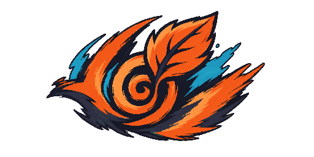
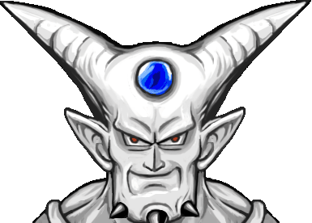

# ĐỢT 1B — LÀM LẠI 343 ẢNH (dành cho AI tạo ảnh)

> **File này tự chứa đủ.** Đọc từ trên xuống, làm theo thứ tự, tự đặt tên file
> đúng như ghi. Kèm thư mục **`anh-tham-chieu/`** — MỞ CÁC ẢNH ĐÓ RA XEM trước
> khi vẽ, đó là điều quan trọng nhất của file này.

---

# ⚠️ VÌ SAO LÔ TRƯỚC BỊ TRẢ LẠI — ĐỌC KỸ PHẦN NÀY

Lô 343 ảnh trước bị trả lại vì **vẽ thành hình khối phẳng vài màu, không phải
tranh thật.** Nội dung/tên thì đúng (hiểu đúng Naruto), nhưng **chất lượng vẽ
hỏng hoàn toàn**: nhân vật ra "cục màu chân que", vật phẩm ra ô vuông phẳng.

**Bằng chứng đo được — dung lượng file nói lên tất cả:**

| Loại | Dung lượng mỗi ảnh | Nghĩa là |
|---|---|---|
| Ảnh ĐẠT (tranh thật, đổ bóng) | **5 – 90 KB** | Nhiều màu, chi tiết, có khối |
| Ảnh HỎNG (lô v3) | **~0,9 KB** | Vài màu, phẳng lì — hình khối vẽ bằng code |

Nếu một ảnh bạn xuất ra **nhẹ hơn ~3 KB**, gần như chắc chắn nó **phẳng và sai** —
làm lại. Ảnh nhân vật/boss/vật phẩm thật phải **hàng chục KB**.

---

# 🖼️ HÌNH THAM CHIẾU — MỞ RA XEM (quan trọng nhất)

Trong thư mục `anh-tham-chieu/`. **Đây là mảnh mà lô trước thiếu** — luật bằng
chữ ("≥40 màu") không đủ, phải NHÌN mẫu.

## ✅ MẪU TỐT — Naruto, đúng chuẩn cần đạt (đã được duyệt)

- **`TOT-naruto-logo.png`** — logo game: hoạ tiết lửa/lá xoáy, màu **cam–xanh–đen**
  đúng hệ làng, **đổ bóng, viền đậm, chuyển màu mượt**. Đây là mức "tranh thật".
- **`TOT-naruto-khung.png`** — khung avatar: khung gỗ/kim loại có độ dày, bo góc,
  hoạ tiết — không phải ô vuông trơn.
- **`TOT-naruto-thanh-chakra.png`** — thanh chakra: có nền rãnh + phần đầy phát sáng.

## ✅ MẪU TỐT — mức chi tiết & đổ bóng cần đạt (tham chiếu KIỂU VẼ, không phải nội dung)

- **`TOT-chitiet-nhanvat.png`** — một nhân vật: **da/kim loại có khối, bóng đổ,
  hàng chục sắc độ, viền sạch, nền trong suốt**. ⚠️ Đây là ảnh game CŨ (không phải
  Naruto) — chỉ tham chiếu **mức độ chi tiết và cách đổ bóng**, KHÔNG vẽ lại nhân
  vật này. Nhân vật Naruto của bạn phải đạt mức chi tiết y như vậy.
- **`TOT-chitiet-hieuung.png`** — một sprite hiệu ứng: nhiều khung hình, ánh sáng,
  chuyển màu — mức chi tiết cho nhóm hiệu ứng.

## ❌ MẪU XẤU — TUYỆT ĐỐI TRÁNH (chính là lô v3 bị trả lại)

- **`XAU-boss-zabuza.png`** — đáng lẽ là ninja băng mặt cầm đại kiếm, nhưng ra
  **cục tím + chân que + vạch đen làm mặt**. 3 màu, phẳng lì, 1 KB. ĐÂY LÀ LỖI.
- **`XAU-npc.png`**, **`XAU-vatpham.png`** — cùng bệnh: hình khối phẳng, không chi tiết.

**So hai bên rồi tự hỏi trước khi nộp mỗi ảnh: "Ảnh của mình gần MẪU TỐT hay MẪU
XẤU hơn?"** Nếu giống mẫu xấu → làm lại.

---

# PHẦN A — LUẬT CHẤT LƯỢNG SẮT (bắt buộc mọi ảnh)

1. **Tranh pixel thật, có đổ bóng và chuyển màu** — tối thiểu **40 màu khác nhau**
   cho ảnh nhân vật/boss/quái/vật phẩm/trang phục. (Giao diện hình khối đơn giản
   như nút bấm có thể ít màu hơn, nhưng vẫn phải có khối/viền, không phẳng lì.)
2. **Nền trong suốt (alpha)** — PNG có kênh alpha, nền hoàn toàn trong.
3. **Không viền sáng quanh mép** (lỗi hay gặp khi tách nền) — mép sạch.
4. **KHÔNG vẽ hình khối bằng code / SVG / vector phẳng.** Phải là tranh có ánh
   sáng, bóng, chất liệu. Nếu ảnh trông như đồ hoạ vector phẳng → SAI.
5. **Dung lượng là dấu hiệu:** ảnh nhân vật/boss/vật phẩm thật thường **> 5 KB**.
   Dưới 3 KB gần như chắc chắn phẳng.

## Bảng màu & màu riêng từng làng

Dùng đúng bảng màu và màu riêng từng làng ở file spec gốc
`DOT-1-PROMPT-TAO-ANH.md` (Phần A2, A3). Tóm tắt màu hệ 5 làng để tiện:
**Làng Lá = Hỏa (cam/đỏ), Làng Cát = Phong (vàng cát/nâu), Làng Sương Mù = Thủy
(xanh dương/xám), Làng Đá = Thổ (nâu/xám đá), Làng Mây = Lôi (tím/vàng chớp).**

## Kích thước & đặt tên

- Kích thước theo từng nhóm ở Phần B (đa số 64×64, giao diện có cỡ riêng).
- **Giữ NGUYÊN tên file cũ** (danh sách ở Phần B) — game gọi theo tên này.
- Xuất `@x4` như tên đang có (ví dụ `boss_zabuza_x4.png`).

## Tự kiểm trước khi nộp mỗi lô

Có sẵn công cụ chấm điểm ở `docs/my-thuat/KIEM-TRA-ANH.ps1`: chuột phải → Run with
PowerShell, trỏ vào thư mục ảnh. Nó báo ảnh nào "hình khối phẳng" để làm lại.
**Chỉ nộp lô khi công cụ báo "LÔ NÀY DÙNG ĐƯỢC".**

---

# PHẦN B — DANH SÁCH 343 ẢNH THEO NHÓM

> Mỗi mục ghi: tên file (giữ nguyên) + vẽ gì. Áp luật Phần A cho MỌI ảnh.
> Nội dung chi tiết hơn (nếu cần) ở `DOT-1-PROMPT-TAO-ANH.md` Phần B cùng số nhóm.

## NHÓM 1 — GIAO DIỆN

Thư mục đích: `01-giao-dien/` — tổng **62 ảnh**. Trong đó **12 ảnh ĐÃ DUYỆT** (giữ nguyên, KHÔNG vẽ lại) và **50 ảnh CẦN LÀM LẠI**.

Phong cách chung của cả nhóm (bám cho mọi ảnh làm lại để khớp bộ với 12 ảnh đã duyệt): giao diện phong cách cuộn giấy / gỗ sơn mài tối (dark lacquered wood) viền cam ấm, mô-típ cuộn ninja, cạnh sạch kiểu vector, đối xứng. Khối phụ gợi ý khi tạo: `UI element, clean vector-like edges, subtle scroll/parchment and dark lacquered wood motif, ninja scroll aesthetic, symmetrical.`

### Nhắc luật chất lượng (ngắn — chi tiết đã ở đầu file)
- KHÔNG vẽ "hình khối phẳng 3 màu" bằng code. Phải là ảnh render thật, có **đổ bóng, bevel, highlight**, chuyển sắc mềm.
- Nền **trong suốt (alpha)**. **Không** viền sáng (glow halo) ở mép ngoài — mép phải là cắt cứng sạch trên nền trong.
- Riêng nhóm giao diện có nhiều khối hình đơn giản (mũi tên, thanh fill, biểu tượng phẳng): được phép ít màu hơn ngưỡng ≥40 màu, **nhưng** vẫn phải có khối/bóng/vát thật — không phải ô màu đặc do code tô. Các icon có nội dung (đồng xu, ngọc, huy hiệu, tranh nền) thì bám ngưỡng nhiều màu + đổ bóng như luật chung.

---

### 1A. MƯỜI HAI ẢNH ĐÃ DUYỆT — GIỮ NGUYÊN, KHÔNG LÀM LẠI

12 ảnh dưới đây đã được duyệt ở lô khác (đúng chất lượng, dùng làm **mẫu tham chiếu phong cách** cho 50 ảnh còn lại). **Bỏ qua — đừng tạo lại.**

| # | Tên file (giữ nguyên) | Kích thước | Nội dung | Trạng thái |
|---|---|---|---|---|
| — | `ui_khung_hoithoai_x4.png` | 480×160 | Khung hộp thoại: panel gỗ sơn mài tối viền cam, ruột giấy cũ, đầu cuộn tròn hai bên, an toàn 9-slice | ✅ ĐÃ XONG |
| — | `ui_nut_thuong_x4.png` | 96×48 | Nút thường: gỗ sơn mài tối, viền cam ấm chạy hết bề ngang, giữa trống, vát nhẹ mép trên, 9-slice safe | ✅ ĐÃ XONG |
| — | `ui_nut_nhan_x4.png` | 96×48 | Nút trạng thái nhấn (pressed): tối hơn rõ, viền cam mờ đi, bóng lõm dọc mép trên | ✅ ĐÃ XONG |
| — | `ui_nut_khoa_x4.png` | 96×48 | Nút trạng thái khoá (disabled): xám xanh bạc màu hoàn toàn, không còn cam, có ổ khoá nhỏ ở nắp phải | ✅ ĐÃ XONG |
| — | `ui_thanh_theluc_nen_x4.png` | 240×32 | Đế thanh thể lực (rỗng): rãnh lõm tối bo tròn hai đầu, viền sáng mảnh, ruột trống | ✅ ĐÃ XONG |
| — | `ui_thanh_theluc_fill_x4.png` | 240×32 | Phần đổ đầy thanh thể lực: dải cam-đỏ đặc, highlight mềm trên, hai mép cắt phẳng vuông | ✅ ĐÃ XONG |
| — | `ui_thanh_chakra_nen_x4.png` | 240×32 | Đế thanh chakra (rỗng): y hệt đế thể lực, tái dùng đúng hình học | ✅ ĐÃ XONG |
| — | `ui_thanh_chakra_fill_x4.png` | 240×32 | Phần đổ đầy chakra: dải xanh cyan, cùng kiểu cắt phẳng và highlight như thanh thể lực | ✅ ĐÃ XONG |
| — | `ui_o_vatpham_x4.png` | 64×64 | Ô vật phẩm trống: ô vuông lõm tối, viền trong mảnh sáng | ✅ ĐÃ XONG |
| — | `ui_o_dangchon_x4.png` | 64×64 | Ô đang chọn: cùng ô nhưng viền cam sáng phát quang, trạng thái selected | ✅ ĐÃ XONG |
| — | `ui_khung_avatar_x4.png` | 96×96 | Khung avatar tròn: vành bện dây thừng, viền gỗ tối, giữa trống | ✅ ĐÃ XONG |
| — | `ui_logo_game_x4.png` | 512×256 | Logo game: phù hiệu kim loại nhìn thẳng — một chiếc lá lớn chỉ lên có xoáy khắc giữa, gắn trên tấm băng trán kim loại có 2 đinh tán và dải vải hai bên; lá cam, tấm thép tối, dải xanh navy | ✅ ĐÃ XONG |

---

### 1B. NĂM MƯƠI ẢNH CẦN LÀM LẠI

Đây là toàn bộ phần phải vẽ lại. Kích thước ghi là kích thước file `_x4` cuối cùng.

#### Nhóm khung/panel lớn (6 ảnh)

| Tên file (giữ nguyên) | Kích thước | Nội dung chi tiết (màu + đặc trưng Naruto) |
|---|---|---|
| `ui_khung_tuido_x4.png` | 480×480 | Panel túi đồ (inventory). Khung gỗ sơn mài tối viền cam, ruột nền giấy cũ ngả vàng, có các đường kẻ lưới mờ chia ô đặt vật phẩm. Phong cách cuộn ninja, đối xứng. Góc bo, vát nhẹ tạo khối. Nền trong suốt ngoài khung. |
| `ui_khung_ruong_x4.png` | 480×480 | Panel kho/rương chứa đồ. Giống túi đồ nhưng **nặng đô hơn**: bốn góc bọc sắt (iron corners) có đinh tán, thân gỗ tối hơn, cảm giác két sắt ninja. Vẫn có lưới ô bên trong. |
| `ui_khung_shop_x4.png` | 480×400 | Panel cửa hàng. Khung gỗ tối viền cam, **phía trên có dải vải/băng-rôn treo** (hanging cloth banner) màu cam-nâu như biển hiệu quán ninja, ruột giấy sáng để bày hàng. |
| `ui_khung_nhiemvu_x4.png` | 400×480 | Panel nhiệm vụ **hình cuộn giấy trải ra** (unrolled scroll): hai trục cuộn gỗ ở trên và dưới, thân giấy da cũ ngả vàng ở giữa để ghi nhiệm vụ, dây buộc cam. Rất "ninja scroll". |
| `ui_khung_thongbao_x4.png` | 400×120 | Banner thông báo nhỏ. Dải ngang gỗ/giấy, **viền phát sáng cam** dịu quanh mép trong (không phải glow halo ngoài mép cắt), tạo cảm giác báo tin thường. |
| `ui_khung_canhbao_x4.png` | 400×120 | Banner cảnh báo. Cùng khổ với thông báo nhưng **viền sáng đỏ**, có **dấu hiệu nguy hiểm nhỏ** (hazard mark) như tam giác cảnh báo hoặc dấu chấm than kiểu ninja. |

#### Thanh (bar) (2 ảnh)

| Tên file (giữ nguyên) | Kích thước | Nội dung chi tiết |
|---|---|---|
| `ui_thanh_kinhnghiem_x4.png` | 240×24 | Thanh kinh nghiệm mảnh. Đế rãnh tối, **phần đầy màu vàng gold** sáng lấp lánh, viền mảnh. Dài và mảnh hơn thanh thể lực. Có thể gộp đế + fill trong một ảnh (thanh mẫu đầy vừa). |
| `ui_thanh_nap_x4.png` | 400×48 | Thanh loading/nạp. Đế rãnh tối dài, **phần đầy màu cam**, ở mép của phần đầy có **một ngôi sao ném (shuriken) nhỏ đang xoay/chạy** — chi tiết Naruto đặc trưng đánh dấu tiến trình. |

#### Nút tròn chức năng 64×64 (11 ảnh)

Tất cả cùng khuôn: nút tròn gỗ sơn mài tối, viền cam ấm, vát khối + bóng, giữa là một **ký hiệu (mark) sáng màu** đặc trưng. Nền trong suốt.

| Tên file (giữ nguyên) | Kích thước | Ký hiệu ở giữa (đặc trưng Naruto) |
|---|---|---|
| `ui_nut_dong_x4.png` | 64×64 | Nút đóng: dấu **X** trên nút tròn gỗ tối. |
| `ui_nut_caidat_x4.png` | 64×64 | Nút cài đặt: **bánh răng lai shuriken** (gear-shuriken hybrid) — vừa là răng cưa vừa là phi tiêu ninja. |
| `ui_nut_chat_x4.png` | 64×64 | Nút chat: **bong bóng thoại** (speech bubble). |
| `ui_nut_bando_x4.png` | 64×64 | Nút bản đồ: **tấm bản đồ gấp** (folded map). |
| `ui_nut_tuido_x4.png` | 64×64 | Nút túi đồ: **túi/bao ninja** (ninja pouch) đeo hông. |
| `ui_nut_kynang_x4.png` | 64×64 | Nút kỹ năng: **dấu kết ấn tay** (hand-seal) — bàn tay bắt ấn ninjutsu. |
| `ui_nut_nhiemvu_x4.png` | 64×64 | Nút nhiệm vụ: **cuộn giấy nhỏ** (scroll). |
| `ui_nut_toidoi_x4.png` | 64×64 | Nút tổ đội: **ba hình người nhỏ** (three small figures) — đội nhóm. |
| `ui_nut_xephang_x4.png` | 64×64 | Nút xếp hạng: **bục podium** (bậc 1-2-3). |
| `ui_nut_thu_x4.png` | 64×64 | Nút thư: **lá thư niêm phong** (sealed letter) có dấu sáp. |
| `ui_nut_danh_x4.png` | 128×128 | Nút tấn công lớn (round attack button, **128×128**): nút tròn to màu cam nổi bật, giữa là **một shuriken** (ngôi sao ném). Đây là nút to nhất, làm nổi. |

#### Mũi tên điều hướng 48×48 (4 ảnh)

Mũi tên dày, màu cam, có khối/vát nhẹ (không phải tam giác phẳng do code). Nền trong suốt.

| Tên file (giữ nguyên) | Kích thước | Nội dung |
|---|---|---|
| `ui_muiten_len_x4.png` | 48×48 | Mũi tên **lên**, dày, cam. |
| `ui_muiten_xuong_x4.png` | 48×48 | Mũi tên **xuống**, dày, cam. |
| `ui_muiten_trai_x4.png` | 48×48 | Mũi tên **trái**, dày, cam. |
| `ui_muiten_phai_x4.png` | 48×48 | Mũi tên **phải**, dày, cam. |

#### Icon tiền tệ 64×64 (4 ảnh)

Icon vật thể 3/4, có đổ bóng, nhiều sắc độ (bám ngưỡng nhiều màu). Nền trong suốt.

| Tên file (giữ nguyên) | Kích thước | Nội dung chi tiết (màu + đặc trưng) |
|---|---|---|
| `ui_tien_ryo_x4.png` | 64×64 | Tiền Ryo: **đồng xu vàng cổ hình bầu dục có lỗ vuông ở giữa**, xếp chồng nghiêng 2 đồng (như tiền koban Nhật). Vàng kim, ánh phản. |
| `ui_tien_ngoc_x4.png` | 64×64 | Ngọc (tiền nạp): **viên đá quý cyan cắt giác** (faceted gemstone), xanh lam sáng, lấp lánh phản quang. |
| `ui_tien_xu_x4.png` | 64×64 | Xu sự kiện: **token nhỏ màu tím** có **dấu xoáy** (spiral mark) — vòng xoáy kiểu Uzumaki. |
| `ui_tien_thoivang_x4.png` | 64×64 | Thỏi vàng: **thanh vàng nén (gold ingot)** hình thang, ánh kim, bóng đổ. |

#### Biểu tượng làng 64×64 (5 ảnh)

Mỗi ảnh: **biểu tượng làng khắc trên tấm kim loại (metal plate)** — mô phỏng ký hiệu băng trán Naruto. Tấm thép tối, ký hiệu nổi. Nền trong suốt.

| Tên file (giữ nguyên) | Kích thước | Ký hiệu làng (Naruto) |
|---|---|---|
| `ui_lang_la_x4.png` | 64×64 | Làng Lá (Konoha): **chiếc lá xoáy cách điệu** trên tấm kim loại. |
| `ui_lang_cat_x4.png` | 64×64 | Làng Cát (Suna): **đồng hồ cát / xoáy hình đồng hồ cát** (hourglass-spiral). |
| `ui_lang_suong_x4.png` | 64×64 | Làng Sương (Kiri): **bốn đường sương lượn sóng** (four wavy mist lines). |
| `ui_lang_da_x4.png` | 64×64 | Làng Đá (Iwa): **hai phiến đá** (two rock slabs). |
| `ui_lang_may_x4.png` | 64×64 | Làng Mây (Kumo): **hình khối mây** (cloud shape). |

#### Icon hệ nguyên tố 64×64 (5 ảnh)

Icon biểu tượng nguyên tố, cách điệu, có khối và ánh sáng. Nền trong suốt.

| Tên file (giữ nguyên) | Kích thước | Nội dung (màu) |
|---|---|---|
| `ui_he_hoa_x4.png` | 64×64 | Hệ Hỏa: **ngọn lửa cách điệu**, đỏ-cam. |
| `ui_he_phong_x4.png` | 64×64 | Hệ Phong: **xoáy gió lượn** (wind curl), xanh lá nhạt. |
| `ui_he_thuy_x4.png` | 64×64 | Hệ Thủy: **giọt nước kèm gợn sóng**, xanh dương. |
| `ui_he_tho_x4.png` | 64×64 | Hệ Thổ: **cụm đá** (rock cluster), nâu. |
| `ui_he_loi_x4.png` | 64×64 | Hệ Lôi: **tia sét** (lightning bolt), vàng-trắng. |

#### Huy hiệu cấp bậc 64×64 (9 ảnh)

Chuỗi huy hiệu cấp bậc ninja tăng dần (tier 1→9). Nền trong suốt, có đổ bóng.

| Tên file (giữ nguyên) | Kích thước | Nội dung (tier + đặc trưng Naruto) |
|---|---|---|
| `ui_bac_hocvien_x4.png` | 64×64 | Tier 1 — Học viên: **dải vải băng trán trơn**, không có tấm kim loại. |
| `ui_bac_genin_x4.png` | 64×64 | Tier 2 — Genin: **tấm kim loại có một khía** (one notch). |
| `ui_bac_chunin_x4.png` | 64×64 | Tier 3 — Chunin: tấm kim loại với **cổ áo gile xanh lá** (green vest collar) phía sau. |
| `ui_bac_jonin_x4.png` | 64×64 | Tier 4 — Jonin: **tấm kim loại viền bạc** (silver trim). |
| `ui_bac_tinhanh_x4.png` | 64×64 | Tier 5 — Tinh anh: tấm kim loại với **hai cánh hai bên** (two side wings). |
| `ui_bac_anbu_x4.png` | 64×64 | Tier 6 — ANBU: **bóng mặt nạ thú màu trắng** (white animal mask silhouette). |
| `ui_bac_kage_x4.png` | 64×64 | Tier 7 — Kage: **bóng mũ chóp nón Kage màu vàng** (conical hat silhouette, gold). |
| `ui_bac_hiennhan_x4.png` | 64×64 | Tier 8 — Hiền nhân (Sage): **mô-típ vạch quanh mắt cóc màu cam** (toad-eye marking). |
| `ui_bac_lucdao_x4.png` | 64×64 | Tier 9 — Lục Đạo: **chín viên magatama xếp thành vòng**, vàng trên nền đen. |

#### Joystick ảo (2 ảnh)

| Tên file (giữ nguyên) | Kích thước | Nội dung |
|---|---|---|
| `ui_joystick_nen_x4.png` | 192×192 | Đế joystick ảo: **vòng tròn tối bán trong suốt** (translucent), có texture dây thừng mờ. Nền trong suốt ngoài vòng. |
| `ui_joystick_num_x4.png` | 96×96 | Núm joystick: **vòm tròn màu cam** (orange dome) có highlight, đổ bóng, đặt lên đế. |

#### Tranh nền (2 ảnh — bám luật tranh: nhiều màu, đổ bóng, cách điệu)

| Tên file (giữ nguyên) | Kích thước | Nội dung chi tiết |
|---|---|---|
| `ui_nen_dangnhap_x4.png` | 1024×576 | Nền màn đăng nhập: **một làng ninja yên tĩnh lúc hoàng hôn nhìn từ sườn đồi**, bóng các mái nhà đổ đen, **mặt trăng lớn**, trời cam ấm. Cách điệu mạnh, ít chi tiết, không gian tĩnh. Đây là ảnh nền (được phép có nền, không cần alpha). |
| `ui_nen_chonlang_x4.png` | 1024×576 | Nền màn chọn làng: **tấm bản đồ năm nước lớn trải trên bàn gỗ tối**, ánh đèn lồng ấm, ít chi tiết. Cảm giác cuộn bản đồ ninja. Ảnh nền (được phép có nền). |

---

**Tổng kiểm:** 62 ảnh = 12 đã duyệt (giữ nguyên) + 50 làm lại. Danh sách 50 ảnh làm lại chia: 6 khung/panel + 2 thanh + 11 nút tròn + 4 mũi tên + 4 tiền tệ + 5 làng + 5 hệ + 9 huy hiệu + 2 joystick + 2 tranh nền = 50. Đủ khớp số file `.png` thật trong thư mục `01-giao-dien/`.

## NHÓM 2 - VẬT PHẨM

Thư mục xuất: `02-vat-pham/` — Tổng **100 ảnh**, tất cả kích thước **64×64 px**, nền trong suốt (alpha).

**Khối phụ dùng cho mọi ảnh nhóm này:** `single game item icon, 3/4 top view, floating, centered, no hands, no background.` (icon vật phẩm nhìn chéo từ trên, vật thể lơ lửng, canh giữa, không có tay người, không nền).

**Nhắc luật chất lượng (áp dụng cho cả 100 ảnh):** phải là tranh pixel/vẽ tay THẬT — có đổ bóng khối, chuyển sắc, bắt sáng kim loại/thủy tinh, dùng **>= 40 màu** (trừ vài icon giao diện đơn giản). Nền TRONG SUỐT, KHÔNG viền sáng ở mép, KHÔNG vẽ hình khối phẳng 3 màu bằng code. File thật nặng ~5-90KB (bản hỏng cũ chỉ ~0.9KB nên bị trả lại).

---

### 2A. Trang bị Làng Lá — 5 bộ phận × 8 cấp = 40 ảnh (64×64)

Mỗi bộ phận có 8 cấp, độ tinh xảo tăng dần theo **thang chất liệu**:

| Cấp | Chất liệu | Gợi ý màu / xử lý |
|---|---|---|
| t1 | vải thô | vải mộc chưa nhuộm, xỉn màu, sờn chỉ |
| t2 | vải bền | vải dệt chắc, màu tươi hơn, đường may gọn |
| t3 | da nhẹ | thêm miếng da nâu, khâu viền da |
| t4 | lưới thép | lớp lưới mắt xích ánh thép xám |
| t5 | giáp nhẹ | gắn mảnh giáp kim loại mỏng, bắt sáng nhẹ |
| t6 | giáp Jonin | phong cách áo giáp Jonin xanh rêu, túi đựng cuộn |
| t7 | giáp ANBU | mảng giáp xám ANBU, khớp nối kim loại tinh xảo |
| t8 | áo choàng Kage | tông trắng-cam Kage, viền chỉ vàng, đường nét cao cấp nhất |

**Áo** — SUBJECT gốc: `a ninja jacket, orange and dark blue accents, high collar` (áo khoác ninja cổ cao, phối cam và xanh navy — kiểu áo đặc trưng của Naruto).

| Tên file | Mô tả |
|---|---|
| `vp_ao_t1_x4.png` | Áo khoác cổ cao vải thô, cam xỉn + navy đậm, sờn vai. 64×64. |
| `vp_ao_t2_x4.png` | Áo cổ cao vải bền, cam tươi hơn, đường may chắc. 64×64. |
| `vp_ao_t3_x4.png` | Áo cam-navy có nẹp da nâu ở vai và cổ. 64×64. |
| `vp_ao_t4_x4.png` | Áo cam-navy lót lớp lưới thép ánh xám ở tay. 64×64. |
| `vp_ao_t5_x4.png` | Áo cam-navy gắn mảnh giáp kim loại mỏng ngực. 64×64. |
| `vp_ao_t6_x4.png` | Áo phối kiểu giáp Jonin xanh rêu, cổ cao, túi cuộn nhỏ. 64×64. |
| `vp_ao_t7_x4.png` | Áo mảng giáp xám ANBU, khớp nối kim loại, cổ cao. 64×64. |
| `vp_ao_t8_x4.png` | Áo choàng Kage trắng-cam tay rộng, viền chỉ vàng. 64×64. |

**Quần** — SUBJECT gốc: `ninja trousers with bandage wraps at the ankles` (quần ninja quấn băng trắng ở cổ chân).

| Tên file | Mô tả |
|---|---|
| `vp_quan_t1_x4.png` | Quần vải thô navy xỉn, băng trắng quấn cổ chân sờn. 64×64. |
| `vp_quan_t2_x4.png` | Quần vải bền navy, băng quấn cổ chân gọn gàng. 64×64. |
| `vp_quan_t3_x4.png` | Quần navy có nẹp da nâu bên hông, băng cổ chân. 64×64. |
| `vp_quan_t4_x4.png` | Quần navy lót lưới thép xám ở đùi, băng cổ chân. 64×64. |
| `vp_quan_t5_x4.png` | Quần navy gắn tấm giáp nhẹ che đùi, băng cổ chân. 64×64. |
| `vp_quan_t6_x4.png` | Quần kiểu Jonin xanh rêu, túi hông, băng cổ chân. 64×64. |
| `vp_quan_t7_x4.png` | Quần giáp ANBU xám, ốp gối kim loại, băng cổ chân. 64×64. |
| `vp_quan_t8_x4.png` | Quần Kage trắng-cam, viền vàng, băng cổ chân sạch đẹp. 64×64. |

**Găng** — SUBJECT gốc: `a pair of fingerless ninja gloves with a metal back plate` (đôi găng ninja hở ngón, có tấm thép ở mu bàn tay — kiểu găng Kakashi).

| Tên file | Mô tả |
|---|---|
| `vp_gang_t1_x4.png` | Đôi găng hở ngón vải thô xanh xỉn, tấm mu bằng vải cứng. 64×64. |
| `vp_gang_t2_x4.png` | Găng hở ngón vải bền xanh, tấm mu vải chắc. 64×64. |
| `vp_gang_t3_x4.png` | Găng hở ngón da nâu, mu tay ốp da khâu viền. 64×64. |
| `vp_gang_t4_x4.png` | Găng hở ngón, mu tay ốp lưới thép xám. 64×64. |
| `vp_gang_t5_x4.png` | Găng hở ngón, tấm thép mu tay bắt sáng nhẹ. 64×64. |
| `vp_gang_t6_x4.png` | Găng Jonin hở ngón xanh rêu, tấm thép mu tay. 64×64. |
| `vp_gang_t7_x4.png` | Găng ANBU xám, ốp giáp mu tay khớp kim loại tinh xảo. 64×64. |
| `vp_gang_t8_x4.png` | Găng Kage trắng-cam, tấm mu mạ vàng viền chỉ vàng. 64×64. |

**Giày** — SUBJECT gốc: `open-toe ninja sandals, dark blue` (dép ninja hở ngón, màu xanh navy — dép shinobi kinh điển).

| Tên file | Mô tả |
|---|---|
| `vp_giay_t1_x4.png` | Dép ninja hở ngón vải thô navy xỉn, quai sờn. 64×64. |
| `vp_giay_t2_x4.png` | Dép hở ngón navy vải bền, quai chắc. 64×64. |
| `vp_giay_t3_x4.png` | Dép hở ngón đế da nâu, quai da khâu viền. 64×64. |
| `vp_giay_t4_x4.png` | Dép hở ngón có nẹp lưới thép quanh cổ chân. 64×64. |
| `vp_giay_t5_x4.png` | Dép hở ngón gắn tấm giáp nhẹ ống chân. 64×64. |
| `vp_giay_t6_x4.png` | Bốt kiểu Jonin xanh rêu hở ngón, quai đôi. 64×64. |
| `vp_giay_t7_x4.png` | Bốt ANBU xám, ốp giáp ống chân kim loại. 64×64. |
| `vp_giay_t8_x4.png` | Dép/bốt Kage trắng-cam, viền chỉ vàng cao cấp. 64×64. |

**Băng trán** — SUBJECT gốc: `forehead protector, metal plate with leaf emblem on a cloth strip` (bảo hộ trán hitai-ate: tấm thép khắc biểu tượng lá xoáy Konoha gắn trên dải vải).

| Tên file | Mô tả |
|---|---|
| `vp_bangtran_t1_x4.png` | Băng trán dải vải thô xanh xỉn, tấm thép xỉn khắc lá xoáy Konoha. 64×64. |
| `vp_bangtran_t2_x4.png` | Băng trán dải vải bền xanh, tấm thép sáng hơn, biểu tượng lá rõ. 64×64. |
| `vp_bangtran_t3_x4.png` | Băng trán dải da nâu, tấm thép khắc lá. 64×64. |
| `vp_bangtran_t4_x4.png` | Băng trán nền lưới thép, tấm biển kim loại khắc lá. 64×64. |
| `vp_bangtran_t5_x4.png` | Băng trán tấm giáp nhẹ bóng, biểu tượng lá nổi. 64×64. |
| `vp_bangtran_t6_x4.png` | Băng trán kiểu Jonin, dải xanh rêu, biển thép khắc lá. 64×64. |
| `vp_bangtran_t7_x4.png` | Băng trán ANBU xám, biển kim loại tinh xảo khắc lá. 64×64. |
| `vp_bangtran_t8_x4.png` | Băng trán Kage, biển mạ vàng khắc lá xoáy, dải trắng-cam. 64×64. |

---

### 2B. Tiêu hao — 12 ảnh (64×64)

| Tên file | Mô tả |
|---|---|
| `vp_vien_theluc_1_x4.png` | Viên thuốc **đỏ** nhỏ bọc trong giấy gói (small red pill in a paper wrapper). Đỏ + trắng giấy. 64×64. |
| `vp_vien_theluc_2_x4.png` | Viên thuốc đỏ cỡ vừa trong **lọ thủy tinh** (medium red pill, glass vial). Đỏ + phản quang thủy tinh trong. 64×64. |
| `vp_vien_theluc_3_x4.png` | Viên thuốc đỏ lớn trong **hũ chạm trổ** (large red pill, ornate jar). Đỏ + hũ gốm/sứ hoa văn. 64×64. |
| `vp_vien_chakra_1_x4.png` | Viên thuốc **xanh dương** nhỏ bọc giấy (small blue pill in paper). Xanh chakra + giấy trắng. 64×64. |
| `vp_vien_chakra_2_x4.png` | Viên thuốc xanh dương cỡ vừa trong lọ thủy tinh (medium blue pill, glass vial). 64×64. |
| `vp_vien_chakra_3_x4.png` | Viên thuốc xanh dương lớn trong hũ chạm trổ (large blue pill, ornate jar). 64×64. |
| `vp_thuoc_giai_x4.png` | Chai **thuốc giải màu xanh lá** nút bần (green antidote bottle with cork). Xanh lá + nút gỗ. 64×64. |
| `vp_bang_gac_x4.png` | Cuộn **băng gạc trắng** có nhãn giấy trơn (rolled white bandage, plain tag, không chữ thập). 64×64. |
| `vp_binh_luong_x4.png` | **Viên binh lương** (soldier pill): viên tròn sẫm màu trong hộp thiếc nhỏ. Nâu sẫm + hộp thiếc bạc. 64×64. |
| `vp_mi_ramen_x4.png` | **Tô ramen** bốc khói có lát **naruto-maki** (khoanh xoáy hồng-trắng). Nước dùng nâu, khói bốc lên. 64×64. |
| `vp_dango_x4.png` | Xiên **dango 3 viên** (three-ball dango skewer). Ba viên bột hồng/trắng/xanh trên que tre. 64×64. |
| `vp_binh_nuoc_x4.png` | **Bình nước bằng da** (leather water flask). Da nâu, nắp và dây đeo. 64×64. |

---

### 2C. Nguyên liệu — 15 ảnh (64×64)

| Tên file | Mô tả |
|---|---|
| `vp_manh_thep_x4.png` | **Mảnh thép** răng cưa lởm chởm (jagged steel shard). Xám kim loại, cạnh bén bắt sáng. 64×64. |
| `vp_cuon_trang_x4.png` | **Cuộn giấy trắng** cuốn tròn, chưa viết (blank paper scroll, rolled). Kem-trắng + trục gỗ. 64×64. |
| `vp_muc_x4.png` | **Nghiên mực** nhỏ kèm bút lông (small ink stone with brush). Đá nghiên đen + bút lông tre. 64×64. |
| `vp_long_chim_x4.png` | **Lông chim** sẫm màu (dark feather). Đen/xám chuyển sắc. 64×64. |
| `vp_da_chakra_tho_x4.png` | **Đá chakra thô**: khối pha lê xanh dương xỉn, đục (raw dull blue crystal chunk). 64×64. |
| `vp_da_chakra_tinh_x4.png` | **Đá chakra tinh**: pha lê xanh dương đã mài, **phát sáng** (polished glowing blue crystal). 64×64. |
| `vp_soi_chakra_x4.png` | **Sợi chakra**: cuộn chỉ xanh dương phát sáng (a coil of glowing blue thread). 64×64. |
| `vp_da_thu_x4.png` | **Da thú** gấp lại (folded piece of animal hide). Nâu, vân da, mép lởm chởm. 64×64. |
| `vp_go_cung_x4.png` | **Gỗ cứng**: khúc gỗ ngắn sẫm màu, đặc (short log of dense dark wood). Vân gỗ nâu sẫm. 64×64. |
| `vp_day_thep_x4.png` | **Dây thép**: cuộn dây thép mảnh (coil of thin steel wire). Xám ánh kim, cuộn tròn. 64×64. |
| `vp_bot_no_x4.png` | **Bột nổ**: túi nhỏ chứa bột đen đang đổ ra (small pouch of black powder, spilling). Túi vải + bột đen. 64×64. |
| `vp_ngoc_lua_x4.png` | **Ngọc lửa**: viên ngọc đỏ như than hồng (red ember gem). Đỏ-cam rực, ánh sáng bên trong. 64×64. |
| `vp_ngoc_gio_x4.png` | **Ngọc gió**: viên ngọc xanh lá nhạt vân xoáy (pale green swirl gem). 64×64. |
| `vp_ngoc_nuoc_x4.png` | **Ngọc nước**: viên ngọc hình giọt nước màu xanh dương (blue droplet gem). Trong, bắt sáng. 64×64. |
| `vp_ngoc_set_x4.png` | **Ngọc sét**: viên ngọc vàng cạnh lởm chởm hình tia chớp (yellow jagged gem). 64×64. |

---

### 2D. Cuộn kỹ năng Làng Lá — 8 ảnh (64×64)

SUBJECT gốc chung: `a technique scroll, rolled parchment tied with a coloured cord, a small emblem seal on the front` (cuộn kỹ thuật: giấy da cuốn, buộc dây màu, mặt trước có con dấu biểu tượng nhỏ). Mỗi cuộn khác nhau ở **biểu tượng + màu dây**.

| Tên file | Mô tả |
|---|---|
| `vp_cuon_phanthan_x4.png` | Cuộn **Phân thân**: biểu tượng hai bóng người chồng lên nhau, **dây trắng** (two overlapping human silhouettes, white cord). 64×64. |
| `vp_cuon_thaythe_x4.png` | Cuộn **Thế thân**: biểu tượng khúc gỗ bắt chéo với chiếc lá, **dây nâu** (a log crossed with a leaf, brown cord). 64×64. |
| `vp_cuon_anthan_x4.png` | Cuộn **Ẩn thân**: biểu tượng vòng xoáy đang mờ dần, **dây xám** (a fading swirl, grey cord). 64×64. |
| `vp_cuon_hoadon_x4.png` | Cuộn **Hỏa độn**: biểu tượng ngọn lửa, **dây đỏ** (a flame, red cord). 64×64. |
| `vp_cuon_kunaibay_x4.png` | Cuộn **Kunai bay**: biểu tượng hai kunai bắt chéo, **dây xám thép** (crossed kunai, steel-grey cord). 64×64. |
| `vp_cuon_tuchakra_x4.png` | Cuộn **Tụ chakra**: biểu tượng dấu chân trên thân cây, **dây xanh lá** (a footprint on a tree trunk, green cord). 64×64. |
| `vp_cuon_hoiphuc_x4.png` | Cuộn **Hồi phục**: biểu tượng bàn tay chữa lành, **dây xanh dương nhạt** (a healing palm, pale blue cord). 64×64. |
| `vp_cuon_lienhoan_x4.png` | Cuộn **Liên hoàn**: biểu tượng vòng xoáy ba nắm đấm, **dây cam** (a spiral of three fists, orange cord). 64×64. |

---

### 2E. Vật phẩm nhiệm vụ — 10 ảnh (64×64)

| Tên file | Mô tả |
|---|---|
| `vp_meo_tora_x4.png` | **Mèo Tora**: mèo tam thể mặt cáu kỉnh, đeo **nơ đỏ** một bên tai (a grumpy calico cat with a red ribbon on one ear). Nhiệm vụ D-rank kinh điển. 64×64. |
| `vp_cuon_troi_x4.png` | **Cuộn Trời**: cuộn giấy có dấu "Thiên", tông **trắng và vàng kim** (scroll with the "sky" seal, white and gold). 64×64. |
| `vp_cuon_dat_x4.png` | **Cuộn Đất**: cuộn giấy có dấu "Địa", tông **nâu và xanh lá sẫm** (scroll with an "earth" seal, brown and dark green). 64×64. |
| `vp_giayphep_thi_x4.png` | **Giấy phép thi**: đơn đăng ký chính thức có **con dấu đỏ** (an official application form with a red stamp). 64×64. |
| `vp_the_dangky_x4.png` | **Thẻ đăng ký**: thẻ gỗ khắc treo trên dây (a wooden registration tag on a cord). 64×64. |
| `vp_bando_xusong_x4.png` | **Bản đồ Xứ Sóng**: bản đồ ven biển cuốn tròn, mở hé một phần (a rolled coastal map, partly unrolled). Giấy da + đường bờ biển. 64×64. |
| `vp_thu_hokage_x4.png` | **Thư Hokage**: lá thư niêm phong có **dấu sáp** (a sealed letter with a wax stamp). Phong bì kem + sáp đỏ. 64×64. |
| `vp_manh_matna_x4.png` | **Mảnh mặt nạ**: mảnh vỡ của **mặt nạ thợ săn trắng** (a broken piece of a white hunter mask). Liên hệ Haku. 64×64. |
| `vp_kiem_gay_x4.png` | **Kiếm gãy**: phần mũi gãy của **thanh đại đao khổng lồ** (the broken tip of an oversized cleaver sword). Liên hệ Zabuza. Thép xám bản to. 64×64. |
| `vp_hop_com_x4.png` | **Hộp cơm bento** đóng kín, bọc khăn vải (a bento box, closed, with a cloth wrap). 64×64. |

---

### 2F. Hộp / rương / khác — 15 ảnh (64×64)

| Tên file | Mô tả |
|---|---|
| `vp_ruong_go_x4.png` | **Rương gỗ** nhỏ, đóng nắp (small wooden chest, closed). Gỗ nâu + đai/khóa kim loại. 64×64. |
| `vp_ruong_sat_x4.png` | **Rương sắt** bọc đai sắt, đóng kín (iron-banded chest, closed). Thân sẫm + đai thép. 64×64. |
| `vp_tui_ninja_x4.png` | **Túi ninja da** (leather ninja pouch). Túi da nâu đeo hông đựng dụng cụ. 64×64. |
| `vp_tui_shuriken_x4.png` | **Túi shuriken**: bao đùi (thigh holster pouch). Bao da/vải đeo đùi kiểu ninja. 64×64. |
| `vp_hop_qua_x4.png` | **Hộp quà** buộc **nơ cam** (gift box with orange ribbon). 64×64. |
| `vp_chia_khoa_x4.png` | **Chìa khóa sắt cũ** (old iron key). Kim loại xám, đầu chìa cổ điển. 64×64. |
| `vp_ve_dichuyen_x4.png` | **Vé dịch chuyển**: bùa giấy có **dấu đỏ** (teleport ticket, paper talisman with a red seal). 64×64. |
| `vp_bua_hosinh_x4.png` | **Bùa hồi sinh**: dải giấy bùa có **ký tự đen** (revival talisman, paper strip with black markings). 64×64. |
| `vp_da_maylan_x4.png` | **Đá may mắn**: cỏ **bốn lá** bọc trong nhựa thông (four-leaf clover encased in resin). Xanh lá + khối nhựa trong. 64×64. |
| `vp_da_baove_x4.png` | **Đá bảo vệ**: đá xám khắc **rune** (protective stone, grey with a rune). 64×64. |
| `vp_da_nangcap_x4.png` | **Đá nâng cấp**: cục đá có **lõi cam phát sáng** (upgrade stone, glowing orange core in rock). 64×64. |
| `vp_hop_gacha_x4.png` | **Hộp gacha**: hộp triệu hồi niêm phong có **dấu xoáy** (a sealed summoning box with a spiral mark). 64×64. |
| `vp_the_doiten_x4.png` | **Thẻ đổi tên**: thẻ trống treo trên dây (a blank name tag on a cord). 64×64. |
| `vp_binh_tayky_x4.png` | **Bình tẩy ký**: bình xịt xóa dấu ấn, màu **trắng** (a wash-bottle for erasing seals, white). 64×64. |
| `vp_da_thanhtay_x4.png` | **Đá thanh tẩy**: mảnh pha lê trong, phớt **trắng** (a clear crystal shard, faintly white). 64×64. |

---

**Tổng kết nhóm 2:** 40 (trang bị) + 12 (tiêu hao) + 15 (nguyên liệu) + 8 (cuộn kỹ năng) + 10 (nhiệm vụ) + 15 (hộp/rương) = **100 ảnh**, tất cả **64×64 px**, nền trong suốt, phong cách icon vật phẩm pixel-art Naruto.

## NHÓM 3 — TRANG PHỤC NHÂN VẬT (36 ảnh) → `03-trang-phuc/`

**Nhắc luật chất lượng (áp cho mọi ảnh nhóm này):** phải là tranh pixel/sprite thật, có tô bóng (shading), chuyển sắc nhiều bước, **≥40 màu** cho mỗi mảnh vải/kim loại (không phải mảng phẳng 3 màu). **Nền trong suốt (alpha)**, không nền trắng, **không viền sáng ở mép**, không vẽ hình khối phẳng bằng code. File thật nặng ~5–90KB; file ~0.9KB là hỏng, phải làm lại.

**Khối phụ (dán vào mọi prompt của nhóm):**
`character sprite part for a 2D side-view game, facing right, neutral idle pose, no background, no shadow, consistent lighting from upper-left, the part must align to a shared body skeleton.`

**Cấu trúc:** 12 bộ trang phục, mỗi bộ **3 mảnh rời** để lắp lên cùng một khung xương (skeleton) chung:
- `_dau_` = **đầu** (tóc / băng trán / mặt nạ / mũ / mặt) — **128×128 px**
- `_than_` = **thân + tay** (áo, giáp, khoác, tay áo, găng) — **128×160 px**
- `_chan_` = **chân** (quần, băng chân, dép ninja / guốc) — **128×128 px**

**Yêu cầu đồng bộ toàn nhóm (bắt buộc):** cả 12 bộ dùng **cùng một tư thế đứng idle, cùng hướng nhìn sang phải, cùng hướng ánh sáng trên–trái**, cùng tỉ lệ cơ thể và cùng điểm nối khớp, để 3 mảnh của bất kỳ bộ nào (và giữa các bộ) ráp vào nhau không lệch. Dép ninja kiểu Naruto = **dép hở ngón (sandal)**, trừ khi mô tả nói khác.

---

### Bộ 1 — `hocvien` (Học viên): đồng phục học viện đơn giản, áo thun, không băng trán, tóc ngắn sẫm

| Tên file | Mảnh | Nội dung vẽ (chi tiết Naruto + màu) | Kích thước |
|---|---|---|---|
| `tp_hocvien_dau_x4.png` | đầu | Tóc **đen/nâu sẫm ngắn**, mặt trẻ con học viện, **KHÔNG đeo băng trán** (chưa tốt nghiệp). Da sáng, má hồng nhẹ. | 128×128 |
| `tp_hocvien_than_x4.png` | thân+tay | Áo thun **màu trung tính (be/xanh xám nhạt)** đơn giản, tay ngắn để hở cẳng tay, không phụ kiện, không giáp. | 128×160 |
| `tp_hocvien_chan_x4.png` | chân | Quần vải lửng màu tối/xanh chàm, **dép ninja hở ngón** màu xanh dương. | 128×128 |

### Bộ 2 — `genin_co` (Genin cơ bản): áo khoác cam–xanh dương, băng trán Làng Lá

| Tên file | Mảnh | Nội dung vẽ (chi tiết Naruto + màu) | Kích thước |
|---|---|---|---|
| `tp_genin_co_dau_x4.png` | đầu | **Băng trán Làng Lá** (tấm kim loại bạc khắc **biểu tượng lá xoáy**, dây vải xanh đậm buộc quanh trán). Tóc sẫm. | 128×128 |
| `tp_genin_co_than_x4.png` | thân+tay | **Áo khoác genin đặc trưng: cam là chính, phối xanh dương ở vai/hai bên**, cổ cao có khóa kéo. Tay dài. | 128×160 |
| `tp_genin_co_chan_x4.png` | chân | Quần **cam** dài, băng vải quấn nhẹ cổ chân, **dép ninja hở ngón** xanh. | 128×128 |

### Bộ 3 — `genin_cai` (Genin cải tiến): như genin_co nhưng thêm giáp vai và thắt lưng đồ nghề

| Tên file | Mảnh | Nội dung vẽ (chi tiết Naruto + màu) | Kích thước |
|---|---|---|---|
| `tp_genin_cai_dau_x4.png` | đầu | **Băng trán Làng Lá** (tấm kim loại khắc lá xoáy), tóc sẫm — giống bộ 2. | 128×128 |
| `tp_genin_cai_than_x4.png` | thân+tay | Áo cam–xanh dương + **một miếng giáp vai** (kim loại/da xám ở vai phải) + **thắt lưng đồ nghề** có túi đựng kunai. | 128×160 |
| `tp_genin_cai_chan_x4.png` | chân | Quần cam, **bao đùi đựng vũ khí** buộc ở đùi phải (túi vải nâu), dép ninja. | 128×128 |

### Bộ 4 — `chunin_luoi` (Chunin lưới): áo lưới đen bên trong, áo ngoài không tay, băng trán

| Tên file | Mảnh | Nội dung vẽ (chi tiết Naruto + màu) | Kích thước |
|---|---|---|---|
| `tp_chunin_luoi_dau_x4.png` | đầu | Băng trán Làng Lá (kim loại + dây xanh đậm), tóc sẫm. | 128×128 |
| `tp_chunin_luoi_than_x4.png` | thân+tay | **Lớp áo lưới đen (mesh)** ôm sát lộ ở cánh tay và cổ, khoác ngoài **áo không tay** màu tối (xanh rêu/xám), để lộ vai. | 128×160 |
| `tp_chunin_luoi_chan_x4.png` | chân | Quần tối màu, **băng bó quấn quanh bắp/cổ chân**, dép ninja hở ngón. | 128×128 |

### Bộ 5 — `chunin_giap` (Chunin giáp): áo giáp chống đạn xanh lá, tay dài

| Tên file | Mảnh | Nội dung vẽ (chi tiết Naruto + màu) | Kích thước |
|---|---|---|---|
| `tp_chunin_giap_dau_x4.png` | đầu | Băng trán Làng Lá, tóc sẫm. | 128×128 |
| `tp_chunin_giap_than_x4.png` | thân+tay | **Áo giáp chống đạn (flak jacket) màu xanh lá đặc trưng Làng Lá**: thân dày, có đường chỉ dọc và cổ đứng cao. Bên trong **tay áo dài xanh đen**. | 128×160 |
| `tp_chunin_giap_chan_x4.png` | chân | Quần xanh đen, **băng quấn cổ chân**, dép ninja. | 128×128 |

### Bộ 6 — `jonin_giap` (Jonin giáp): giáp xanh lá có túi cuộn giấy, băng quấn tay, khẩu trang (tuỳ chọn)

| Tên file | Mảnh | Nội dung vẽ (chi tiết Naruto + màu) | Kích thước |
|---|---|---|---|
| `tp_jonin_giap_dau_x4.png` | đầu | Băng trán Làng Lá + **khẩu trang vải sẫm che nửa dưới mặt** (kiểu Kakashi), tóc sẫm. | 128×128 |
| `tp_jonin_giap_than_x4.png` | thân+tay | Giáp chống đạn **xanh lá có thêm túi đựng cuộn giấy (scroll pouch)** ở ngực/hông, **băng vải quấn hai cẳng tay**. | 128×160 |
| `tp_jonin_giap_chan_x4.png` | chân | Quần xanh đen, **bao đùi đựng vũ khí** ở đùi, băng cổ chân, dép ninja. | 128×128 |

### Bộ 7 — `anbu` (ANBU): giáp xám tấm, mặt nạ thú trắng, bảo hộ tay, áo choàng ngắn

| Tên file | Mảnh | Nội dung vẽ (chi tiết Naruto + màu) | Kích thước |
|---|---|---|---|
| `tp_anbu_dau_x4.png` | đầu | **Mặt nạ động vật màu trắng sứ có vằn đỏ/đen** (mặt nạ ANBU, kiểu mèo/chim), tóc thò ra sau. Không băng trán. | 128×128 |
| `tp_anbu_than_x4.png` | thân+tay | **Giáp ngực tấm màu xám kim loại**, **miếng bảo hộ cánh tay (arm guard) xám**, khoác **áo choàng ngắn** tối màu ở vai. | 128×160 |
| `tp_anbu_chan_x4.png` | chân | Quần tối, **giáp ống chân (shin guard) xám**, giày/dép ANBU. | 128×128 |

### Bộ 8 — `kage` (Kage/Thủ lĩnh): áo choàng trắng–cam tay rộng, mũ nón chóp cầm tay (không đội)

| Tên file | Mảnh | Nội dung vẽ (chi tiết Naruto + màu) | Kích thước |
|---|---|---|---|
| `tp_kage_dau_x4.png` | đầu | Tóc + mặt uy nghi lớn tuổi, **KHÔNG đội mũ** (mũ được cầm ở tay — nằm ở mảnh thân). Có thể có băng trán. | 128×128 |
| `tp_kage_than_x4.png` | thân+tay | **Áo choàng Kage trắng, viền/lót cam, tay áo rất rộng**, một tay **cầm chiếc mũ nón hình chóp (Kage hat)** trắng–đỏ. | 128×160 |
| `tp_kage_chan_x4.png` | chân | Phần dưới **áo choàng dài trắng** phủ, thấp thoáng quần trắng và dép ninja bên dưới. | 128×128 |

### Bộ 9 — `tuluyen` (Tự luyện/Tập luyện): áo không tay, tay quấn băng, vòng tạ ở mắt cá

| Tên file | Mảnh | Nội dung vẽ (chi tiết Naruto + màu) | Kích thước |
|---|---|---|---|
| `tp_tuluyen_dau_x4.png` | đầu | Tóc sẫm, **khăn/dây vải buộc đầu kiểu tập luyện** (hoặc băng trán vải không tấm kim loại), mặt trẻ. | 128×128 |
| `tp_tuluyen_than_x4.png` | thân+tay | **Áo ba lỗ/không tay** màu trơn (trắng ngà/xanh xám), **hai cẳng tay quấn băng vải trắng** dày. | 128×160 |
| `tp_tuluyen_chan_x4.png` | chân | Quần tập rộng, **vòng tạ nặng (weighted band) màu kim loại tối ở hai mắt cá chân**, dép ninja. | 128×128 |

### Bộ 10 — `lehoi` (Lễ hội): yukata cam họa tiết lá

| Tên file | Mảnh | Nội dung vẽ (chi tiết Naruto + màu) | Kích thước |
|---|---|---|---|
| `tp_lehoi_dau_x4.png` | đầu | Tóc chải gọn cho lễ hội, không băng trán chiến đấu; có thể điểm phụ kiện nhỏ. Mặt tươi. | 128×128 |
| `tp_lehoi_than_x4.png` | thân+tay | **Áo yukata cam** phối **họa tiết lá xoáy Làng Lá**, cổ chéo vạt truyền thống, **đai obi** màu tương phản (đỏ/xanh) buộc eo, tay áo kiểu kimono. | 128×160 |
| `tp_lehoi_chan_x4.png` | chân | Phần dưới yukata cam dài, **guốc gỗ geta** kiểu Nhật thò ra dưới gấu. | 128×128 |

### Bộ 11 — `aomua` (Áo mưa): áo tơi rơm và nón lá rộng vành

| Tên file | Mảnh | Nội dung vẽ (chi tiết Naruto + màu) | Kích thước |
|---|---|---|---|
| `tp_aomua_dau_x4.png` | đầu | **Nón lá rộng vành (kasa) màu rơm/vàng nâu** che kín đầu, chỉ thấy nửa dưới mặt trong bóng nón. | 128×128 |
| `tp_aomua_than_x4.png` | thân+tay | **Áo tơi rơm (mino)** rủ nhiều sợi rơm khô màu nâu vàng phủ vai và thân, kết cấu sợi rối tự nhiên. | 128×160 |
| `tp_aomua_chan_x4.png` | chân | Gấu áo tơi rơm rủ xuống, quần tối bên trong, **guốc/dép đi mưa**. | 128×128 |

### Bộ 12 — `anthan` (Ẩn thân/Tàng hình): trang phục lén toàn xám tối, kéo mũ trùm, khăn che mặt

| Tên file | Mảnh | Nội dung vẽ (chi tiết Naruto + màu) | Kích thước |
|---|---|---|---|
| `tp_anthan_dau_x4.png` | đầu | **Mũ trùm đầu (hood) kéo lên** màu xám than + **khăn vải che kín nửa dưới mặt**, chỉ hở đôi mắt, tông tối đồng nhất. | 128×128 |
| `tp_anthan_than_x4.png` | thân+tay | **Áo choàng/áo bó toàn màu xám than tối**, kín cổ, kín tay, không phản quang, thiết kế gọn để ẩn nấp. | 128×160 |
| `tp_anthan_chan_x4.png` | chân | Quần xám than tối, băng quấn cổ chân màu tối, **dép ninja sẫm** — toàn bộ tối màu để hòa vào bóng đêm. | 128×128 |

---

**Tổng: 36 ảnh** = 12 bộ × 3 mảnh (đầu / thân+tay / chân). Đã liệt kê đủ đúng theo các file `.png` thật trong `03-trang-phuc/`. Nhớ: mọi mảnh phải khớp cùng khung xương, cùng tư thế idle nhìn phải, cùng hướng sáng trên–trái; nền trong suốt; là pixel-art có tô bóng ≥40 màu, không phải mảng phẳng.

## NHÓM 4 — VŨ KHÍ (20 ảnh) → `04-vu-khi/`

> **Nhắc chất lượng (nhóm này):** Vẽ **pixel art thật**, có **đổ bóng** trên kim loại/gỗ (highlight sáng ở cạnh lưỡi + vùng tối ở gờ), **>=40 màu** (kể cả các sắc độ xám thép). **Nền trong suốt (alpha)** — không nền trắng, không nền màu. **Không viền sáng (glow/outline) ở mép**. **Không dùng code vẽ hình khối phẳng 3 màu** — đó chính là lỗi khiến lô cũ bị trả lại (file chỉ ~0.4KB; bản đạt phải 5–90KB).

**Bố cục chung cho cả nhóm:** một vũ khí đơn lẻ, **nhìn ngang (side view)**, lưỡi/mũi chĩa lên **góc phải trên 45°**, **không có tay người cầm**. Vật thể chiếm gần hết khung, canh giữa.

**Kích thước:** cột dưới ghi **cỡ gốc**; tên file có hậu tố `_x4` nghĩa là **xuất bản phóng 4 lần** cỡ gốc (đây mới là kích thước pixel thật của file giao). Mặc định cỡ gốc **96×48** trừ khi ghi khác.

| # | Tên file (giữ nguyên) | Vũ khí (đặc trưng Naruto) | Mô tả chi tiết màu + chi tiết cần vẽ | Cỡ gốc → file x4 (px) |
|---|---|---|---|---|
| 1 | `vk_kunai_thuong_x4.png` | Kunai thường | Dao ném hình thoi/lá cổ điển của ninja. Lưỡi **thép xám bạc** có gờ sống giữa (highlight trắng dọc lưỡi, tối dần về cạnh). Chuôi **quấn vải nâu/be** thô. Đuôi chuôi có **vòng khuyên tròn** bằng kim loại. | 96×48 → 384×192 |
| 2 | `vk_kunai_thep_x4.png` | Kunai thép (bản tinh luyện) | Cùng dáng kunai thường nhưng **thép sáng bóng hơn**, ánh xanh-bạc lạnh, highlight mạnh. Vải quấn chuôi **màu xanh dương**. Vòng khuyên đuôi sáng kim loại. | 96×48 → 384×192 |
| 3 | `vk_kunai_no_x4.png` | Kunai gắn bùa nổ | Kunai thường + **lá bùa giấy trắng ngà** (explosive tag) có **chữ/ký tự đỏ và đen** buộc lủng lẳng vào vòng khuyên đuôi. Mép giấy hơi cong, có nếp gấp. | 96×48 → 384×192 |
| 4 | `vk_kunai_ba_x4.png` | Kunai ba chấu (Hiraishin — của Minato) | Kunai **ba lưỡi chĩa**: lưỡi giữa dài thẳng, hai lưỡi bên cong hắt ra ngoài. Trên thân/lưỡi khắc **dấu ấn thuật (seal) màu đen**. Thép xám lạnh, chuôi quấn vải. | 96×48 → 384×192 |
| 5 | `vk_shuriken_x4.png` | Phi tiêu (shuriken 4 cánh) | Ngôi sao ném **thép xám**, **4 cánh nhọn đối xứng**, cạnh vát sắc (highlight ở mũi cánh), **lỗ tròn ở tâm**. Nhìn thẳng mặt sao. | **64×64** → 256×256 |
| 6 | `vk_shuriken_lon_x4.png` | Đại phi tiêu (Fūma shuriken — loại gấp lớn) | Shuriken **khổng lồ 4 lưỡi lớn** hình **lưỡi liềm** cong, thép xám xanh, bản lưỡi rộng có gờ sáng. Tâm có **chốt/đinh tán** tròn nối các lưỡi (loại có thể gấp lại). | **96×96** → 384×384 |
| 7 | `vk_senbon_x4.png` | Kim châm senbon | **Bó ba cây kim thép mảnh, dài**, hai đầu vót nhọn như kim khâu lớn. Thân kim ánh bạc, có **dây/nút buộc** ở giữa gom lại. | 96×48 → 384×192 |
| 8 | `vk_tanto_x4.png` | Đoản kiếm tantō | Kiếm **thẳng, ngắn**, lưỡi thép thẳng có sống rõ. **Chắn tay (tsuba) hình vuông**. Chuôi quấn vải chéo. Highlight dọc lưỡi thép. | 96×48 → 384×192 |
| 9 | `vk_kiem_ngan_x4.png` | Kiếm ngắn cong | Lưỡi **cong nhẹ** kiểu wakizashi, thép sáng. Bên cạnh đặt **bao kiếm (scabbard) màu tối** (đen/nâu sẫm), có dây đai. | 96×48 → 384×192 |
| 10 | `vk_dao_doi_x4.png` | Song đao (cặp đao đôi) | **Một cặp đoản đao giống hệt nhau bắt chéo chữ X**. Lưỡi thép xám, chuôi quấn vải cùng màu. Hai lưỡi phản chiếu đối xứng. | 96×48 → 384×192 |
| 11 | `vk_cuon_no_x4.png` | Cuộn bùa nổ (explosive scroll) | **Cuộn giấy** trải hé, bề mặt in **ký hiệu/chữ đỏ** (kiểu chữ "nổ"). Hai đầu là **thanh cuộn gỗ nâu**. Giấy màu kem, có bóng đổ ở nếp cuộn. | **64×64** → 256×256 |
| 12 | `vk_bom_khoi_x4.png` | Bom khói | **Quả cầu nhỏ màu đen**, bề mặt kim loại có highlight tròn. **Ngòi/dây cháy** nhô lên trên (dây bện nâu, có thể chấm sáng ở đầu ngòi). | **64×64** → 256×256 |
| 13 | `vk_bom_dinh_x4.png` | Bom đinh / chông (makibishi) | **Cụm chông thép 4 gai nhọn** chĩa ra bốn hướng (caltrop), đặt nằm. Thép xám, mỗi gai có highlight ở mũi và vùng tối ở gốc. | **64×64** → 256×256 |
| 14 | `vk_day_thep_cuon_x4.png` | Cuộn dây thép ninja | **Cuộn/lô dây thép** quấn tròn nhiều vòng, ánh **xám bạc kim loại**, các vòng dây song song có sáng-tối xen kẽ tạo khối trụ. Đầu dây thò ra một đoạn. | **64×64** → 256×256 |
| 15 | `vk_quat_gio_x4.png` | Quạt gió chiến (quạt của Temari) | **Quạt gấp lớn** xòe ra, nền **màu kem/trắng ngà**, in **ba mặt trăng tròn màu tím** xếp dọc theo thân quạt. **Nan quạt màu tối** (nâu sẫm/đen), có cán cầm bên dưới. | 96×48 → 384×192 |
| 16 | `vk_bua_lon_x4.png` | Đại đao bản lớn (Kubikiribōchō — của Zabuza) | **Kiếm chặt khổng lồ dáng dao phay**: bản lưỡi rất to, thép xám, gần mũi có **một lỗ bầu dục (oval) khoét thủng**. Sống dao dày, lưỡi sáng bóng, chuôi tròn quấn. | 96×48 → 384×192 |
| 17 | `vk_giao_x4.png` | Giáo ngắn | **Cán gỗ nâu** dài, đầu là **mũi giáo hình lá** bằng thép (leaf-shaped head), có gờ sống giữa và highlight cạnh. Cổ giáo có đai buộc kim loại. | 96×48 → 384×192 |
| 18 | `vk_chuy_x4.png` | Chùy đá | **Cán gỗ**, đầu là **khối đá thô màu xám** nặng (stone head), bề mặt đá lởm chởm có sáng-tối tạo khối. Dây quấn nối đầu đá vào cán. | 96×48 → 384×192 |
| 19 | `vk_cung_x4.png` | Cung ngắn (recurve) | **Cung gỗ ngắn cong ngược (recurve)**, dáng **không căng dây** (unstrung, thân cong tự do). Thân gỗ nâu vân, hai đầu bịt sừng/kim loại sáng. | 96×48 → 384×192 |
| 20 | `vk_con_roi_tay_x4.png` | Đoạn tay con rối (rối của Sasori/Kankurō) | **Một khúc cánh tay con rối bằng gỗ** với **các khớp nối tròn** (joint) giữa các đốt. Gỗ nâu sơn mài, có **lưỡi dao thép giấu** thò ra ở khớp. Chi tiết cơ khí gỗ + kim loại xen kẽ. | **96×96** → 384×384 |

**Ghi chú chốt nhóm 4:** cả 20 file đều là kim loại/gỗ — điểm sống còn là **đổ bóng khối trụ/khối lưỡi** và **dải highlight thép** chạy dọc lưỡi, tuyệt đối không phải mảng màu phẳng. Nền phải **trong suốt hoàn toàn** để ghép vào giao diện túi đồ trong game.

## NHÓM 5 — QUÁI

**Nhắc luật chất lượng (áp dụng cho mọi ảnh nhóm này):** vẽ tranh pixel-art thật, có đổ bóng (shading) và độ chuyển sáng-tối, dùng **>= 40 màu**. **Nền trong suốt (alpha)** — không nền trắng, không ô vuông. **Không viền sáng (rim light) ở mép**. Tuyệt đối không xuất "hình khối phẳng 3 màu" do code vẽ ra. File hỏng đợt trước chỉ ~0.9KB/ảnh; ảnh đạt phải nặng khoảng **5–90KB**.

**Khối chung (áp cho cả 12 con quái):** sprite sinh vật cho game 2D nhìn ngang (side-view), **quay mặt sang phải**, side profile, tư thế đứng yên (idle stance), thấy **toàn thân**, nền trong suốt, **không đổ bóng**.

**Kích thước:** hiển thị trong game **96×96 px**; xuất file ở **×4 = 384×384 px** (đúng hậu tố `_x4` trong tên file). Giữ nhân vật lọt gọn trong khung, chừa lề trong suốt quanh mép.

**Bối cảnh chung:** đây là quái cấp thấp vùng rừng / ngoại ô Làng Lá (Konoha) quanh Học viện Ninja trong game phong cách Naruto — phong cách sprite giống Ngọc Rồng Online, đường nét gọn, khối màu rõ nhưng vẫn phải có pixel shading thật.

| # | Tên file (giữ nguyên) | Nội dung & chi tiết đặc trưng (màu, đặc điểm Naruto) | Kích thước |
|---|---|---|---|
| 1 | `quai_bia_go_x4.png` | **Bia gỗ tập luyện** — cọc gỗ hình người dùng để luyện đòn ở sân Học viện Ninja. Thân gỗ nâu quấn dây thừng (màu be/nâu nhạt), có các **vòng bia đích sơn đỏ-trắng** ở giữa ngực. Đây là "quái" tập đánh đầu tiên, đứng bất động. Vân gỗ và vết xước tạo bằng shading nâu đậm/nhạt. | 96×96 (xuất ×4 = 384×384) |
| 2 | `quai_soi_rung_x4.png` | **Sói rừng** — sói xám gầy, dáng thấp săn mồi, đang **nhe nanh gầm gừ**. Lông xám xanh chuyển sang xám sáng ở bụng, mắt vàng, răng nanh trắng, tai dựng. Bờm và đuôi rậm, chân thon. | 96×96 (xuất ×4 = 384×384) |
| 3 | `quai_lon_rung_x4.png` | **Lợn rừng** — heo rừng lông cứng dựng, thân nâu sẫm/xám, **cặp nanh cong sứt mẻ** màu ngà vàng chìa ra hai bên mõm. Dáng lùn chắc, chân ngắn, mắt nhỏ đỏ giận dữ, bờm lông dựng dọc sống lưng. | 96×96 (xuất ×4 = 384×384) |
| 4 | `quai_chim_ung_x4.png` | **Chim ưng săn mồi** — ưng nâu, **cánh dang nửa chừng** như chuẩn bị vồ. Lông nâu đậm chuyển vàng nâu, mỏ khoằm vàng, móng vuốt sắc, mắt vàng dữ. Có thể đứng trên cành/đá hoặc bay thấp. | 96×96 (xuất ×4 = 384×384) |
| 5 | `quai_nhen_doc_x4.png` | **Nhện độc** — nhện thân tím, **cụm mắt vàng** (nhiều mắt xếp thành chùm) sáng, tám chân dài khẳng khiu màu tím đậm. Bụng phồng có hoa văn độc, răng nanh (kìm) nhỏ. Điểm nhấn tương phản tím–vàng. | 96×96 (xuất ×4 = 384×384) |
| 6 | `quai_ca_sau_x4.png` | **Cá sấu sông** — cá sấu bò thấp, thân dài sát đất. Da xanh lục/xám rêu, lưng nổi các **hàng vảy gai** chạy dọc tới đuôi, hàm dài đầy răng nhọn trắng, mắt vàng gồ lên. Sinh vật vùng sông gần rừng. | 96×96 (xuất ×4 = 384×384) |
| 7 | `quai_ran_lon_x4.png` | **Rắn lớn** — rắn xanh thân to **cuộn tròn, ngóc đầu cao** trong tư thế tấn công. Vảy xanh lục bóng chuyển vàng ở bụng, mắt khe (con ngươi dọc) vàng, lưỡi chẻ đỏ thè ra, nanh độc. Gợi tới hệ rắn của Orochimaru trong Naruto. | 96×96 (xuất ×4 = 384×384) |
| 8 | `quai_khi_rung_x4.png` | **Khỉ rừng** — khỉ **mặt đỏ nhe răng** hung dữ. Lông nâu/xám, mặt và mông đỏ đặc trưng, răng nanh trắng lộ, mắt nhỏ giận. Tư thế khom người, tay dài. | 96×96 (xuất ×4 = 384×384) |
| 9 | `quai_bo_cap_x4.png` | **Bọ cạp** — bọ cạp đen, **đuôi giương cao** với ngòi độc cong ở cuối. Thân giáp đen ánh nâu/tím, hai càng kẹp lớn phía trước, các đốt đuôi rõ, ngòi độc điểm sáng. Sinh vật sa mạc/đất khô. | 96×96 (xuất ×4 = 384×384) |
| 10 | `quai_ninja_gia_x4.png` | **Ninja giả (cướp bịt mặt)** — tên cướp/ninja rởm đeo **khăn bịt mặt tối màu**, mặc đồ rách rưới xám đen, tay **cầm đoản đao (dao ngắn)** ánh thép. Chỉ hở đôi mắt gian, có thể đeo bao tay/băng vải. Kẻ địch dạng người đầu tiên, kiểu ninja phản diện cấp thấp trong thế giới Naruto. | 96×96 (xuất ×4 = 384×384) |
| 11 | `quai_linh_danhthue_x4.png` | **Lính đánh thuê** — chiến binh mặc **giáp chắp vá không đồng bộ** (mảnh da, mảnh kim loại xỉn màu), **cầm giáo (thương)** dài mũi thép. Áo giáp nâu/xám gỉ, có thể đeo băng trán không rõ phù hiệu làng. Kẻ địch dạng người mạnh hơn ninja giả. | 96×96 (xuất ×4 = 384×384) |
| 12 | `quai_nguoi_rom_x4.png` | **Người rơm** — hình nộm rơm biết cử động, được **luồng chakra xanh mờ điều khiển** (các sợi chỉ chakra xanh lam phát sáng nhạt nối vào thân). Thân bằng rơm vàng bó lại, dây thừng buộc, đầu tròn kiểu bù nhìn. Chi tiết Naruto: sợi chỉ chakra (gợi nhẫn thuật thao túng/con rối), ánh xanh phải mờ chứ không phải viền sáng ở mép. | 96×96 (xuất ×4 = 384×384) |

**Tổng: 12 ảnh** — khớp đủ 12 file `.png` trong thư mục `05-quai/` và đúng ghi chú "12 quái". Tất cả giữ nguyên tên file cũ (tên đặt đúng nội dung Naruto, chỉ chất lượng cần làm lại).

## NHÓM 6 — BOSS (6 ảnh) → thư mục `06-boss/`

**Nhắc chất lượng riêng cho nhóm này (đọc kỹ):** Đây là nhóm KHÓ NHẤT. Mỗi ảnh là một nhân vật boss có tạo hình phức tạp, TUYỆT ĐỐI không được ra "cục màu" phẳng hay khối hình chân què. Bắt buộc: tranh pixel thật, có đổ bóng khối cơ thể/quần áo, >=40 màu, có chi tiết mặt và trang phục rõ. Nền TRONG SUỐT (alpha), KHÔNG nền trắng, KHÔNG viền sáng ở mép, KHÔNG dùng code vẽ hình khối.

**Kiểu dáng chung (áp cho cả 6 ảnh):** Sprite boss nhìn nghiêng cho game 2D side-view, **mặt xoay sang PHẢI**, tư thế đứng uy hiếp/oai vệ, **full body (toàn thân)**, nền trong suốt, KHÔNG bóng đổ dưới chân, có **rim light (viền sáng nhẹ tách khỏi nền) mạnh hơn** so với sprite thường để boss nổi bật.

**Kích thước mỗi ảnh:** **160×160 px** (lớn hơn NPC/quái thường vì boss cần nhiều chi tiết).

**Số lượng:** 6 ảnh (khớp đủ 6 file .png thật trong thư mục).

| # | Tên file (giữ nguyên) | Nhân vật | Mô tả chi tiết (màu + đặc trưng Naruto) | Kích thước |
|---|---|---|---|---|
| 1 | `boss_mizuki_x4.png` | Mizuki | Giáo viên học viện phản bội. **Tóc bạc trắng** dài ngang vai, khuôn mặt đang **nhếch mép cười gian xảo (sneering)**. Mặc **đồng phục ninja tối màu** (xanh đen/xám chì), sau lưng đeo một **ngôi sao ném (shuriken) khổng lồ** hình chong chóng 4 cánh bằng kim loại xám bạc. Da sáng, ánh mắt nham hiểm. Tư thế nghiêng người đe dọa. | 160×160 |
| 2 | `boss_zabuza_x4.png` | Zabuza | Kiếm sĩ cao lớn, **nửa dưới mặt quấn băng vải trắng** (che miệng cằm), để **lộ thân trên trần** cơ bắp. Hai cánh tay đeo **băng sọc (arm warmers có kẻ sọc)**. Sau lưng vác một **thanh đại đao/dao phay khổng lồ (cleaver)** lưỡi rộng có lỗ khoét đặc trưng, ánh thép xám. Dưới chân có **lớp sương mù (mist)** loãng trắng xám. Da rám nắng, ánh mắt lạnh. | 160×160 |
| 3 | `boss_haku_x4.png` | Haku | Nhân vật mảnh khảnh, đeo **mặt nạ thợ săn màu trắng có hoa văn/vạch đỏ (red markings)** che mặt. Mặc **kimono màu xanh lá nhạt (pale green)**, dáng thanh mảnh nhẹ nhàng. Giữa các ngón tay kẹp những **cây kim châm senbon** mảnh, sáng kim loại. Tóc đen. Phong thái tĩnh nhưng nguy hiểm. | 160×160 |
| 4 | `boss_ran_khonglo_x4.png` | Rắn khổng lồ (Boss triệu hồi) | Một con **mãng xà (rắn) khổng lồ màu tím** đang **ngóc đầu dựng cao (rearing up)** trong tư thế tấn công. **Mắt vàng có con ngươi khe dọc (yellow slit eyes)**, **nanh phô ra (fangs bared)**. Vảy tím có chuyển sắc đậm nhạt, bụng sáng hơn. Thân uốn lượn to lớn, uy hiếp. Không phải người — đây là quái boss cỡ lớn. | 160×160 |
| 5 | `boss_trom_bitmat_x4.png` | Trùm trộm bịt mặt | Một **tên trùm cướp to con vạm vỡ (hulking) đeo mặt nạ/khăn bịt mặt**. Một cánh tay **quấn xích sắt nặng (heavy chain)** làm vũ khí. Trang phục thô kệch tối màu (nâu/xám), thân hình đồ sộ đầy đe dọa, dáng đứng bặm trợn. | 160×160 |
| 6 | `boss_orochimaru_x4.png` | Orochimaru | Nhân vật **da tái nhợt (pale)**, **tóc đen dài** thẳng. **Mắt vàng kiểu mắt rắn (golden snake eyes)** sắc lạnh. Thắt **dây thừng tím (purple rope belt)** quanh eo. Nửa người **chìm trong bóng tối (half-hidden by shadow)** tạo cảm giác bí ẩn ma quái — vẫn phải giữ nền trong suốt, phần tối là do đổ bóng khối chứ không phải nền đen. Đây là boss nguy hiểm nhất, tạo hình phải tinh xảo. | 160×160 |

**Lưu ý xử lý riêng khi vẽ nhóm boss:**
- Vì boss chi tiết cao, ưu tiên vẽ rõ **khuôn mặt/mặt nạ, vũ khí đặc trưng (đại đao, shuriken khổng lồ, xích, kim senbon)** — đây là điểm nhận diện của từng boss, không được lược bỏ thành mảng màu.
- Phối màu bám đúng nguyên tác: Mizuki tóc bạc + đồ tối; Zabuza thân trần + băng trắng + thép xám; Haku xanh lá nhạt + mặt nạ trắng vạch đỏ; Rắn tím mắt vàng; Trùm trộm nâu/xám + xích sắt; Orochimaru da tái + tóc đen + dây tím + mắt rắn vàng.
- Rim light mạnh nhưng **không được biến thành viền sáng trắng bao quanh toàn thân** (lỗi glow mép) — chỉ tách nhẹ mép để boss nổi trên nền trong suốt.

## NHÓM 7 - NPC

**Nhắc luật chất lượng (rất ngắn):** mọi ảnh phải là **tranh pixel-art vẽ tay thật**, có đổ bóng cel (sáng/tối/viền tối), **>=40 màu** cho nhân vật; **nền trong suốt (alpha)**, KHÔNG nền trắng, KHÔNG viền sáng ở mép, KHÔNG dựng hình khối phẳng bằng code. File đúng phải nặng ~5-90KB (không phải ~0.9KB).

Nhóm này gồm **15 nhân vật NPC**, mỗi nhân vật **2 ảnh** nên tổng **30 ảnh**:
- `npc_<mã>_x4.png` — **sprite thân người đứng**, nhìn nghiêng cạnh (side-view), **quay mặt sang PHẢI**, đứng idle, toàn thân. Cỡ gốc **96×128 px** (đây là ảnh "_x4" nên cạnh thực tế có thể là bội số 4 của cỡ gốc — giữ đúng tỉ lệ 96×128, tức 3:4 dọc).
- `cd_<mã>_x4.png` — **chân dung bán thân (bust)**, lấy từ vai lên, **hơi quay sang TRÁI**, biểu cảm trung tính, tô cel-shading phẳng. Cỡ gốc **200×200 px** (vuông 1:1).

Toàn bộ nhân vật cùng phong cách Naruto/ninja làng Lá: đồng phục ninja xanh rêu, băng trán kim loại (tấm thép xám + dải vải), tông màu da người, ánh sáng chiếu từ trên-trái để bóng đổ nhất quán.

---

### 1. Hokage đời 3 (`hokage3`) — thủ lĩnh làng già
- **`npc_hokage3_x4.png`** — Sprite thân người, quay phải, cỡ **96×128**. Ông già thủ lĩnh mặc **áo choàng trắng viền đỏ/cam**, đội **nón chóp (conical hat) đỏ-trắng** kiểu mũ Hokage (KHÔNG có chữ), râu-tóc bạc xám, đang ngậm **tẩu thuốc dài**, dáng vẻ hiền từ nhưng mệt mỏi. Bảng màu: trắng ngà, đỏ son, xám bạc, da hồng nhạt, nâu tẩu — cần đủ sắc độ đổ bóng nếp áo choàng.
- **`cd_hokage3_x4.png`** — Chân dung bán thân, hơi quay trái, cỡ **200×200**. Cận mặt ông già: nếp nhăn, râu bạc, ánh mắt hiền, vành nón đỏ-trắng che phần trán, làn khói mảnh từ tẩu. Tả rõ đổ bóng da và độ chuyển của vải áo.

### 2. Iruka — thầy giáo trẻ (`iruka`)
- **`npc_iruka_x4.png`** — Sprite thân người, quay phải, cỡ **96×128**. Thầy giáo trẻ, **tóc nâu buộc đuôi ngựa dựng**, **vết sẹo ngang sống mũi**, mặc **áo vest xanh rêu (flak vest) chunin** ngoài đồ ninja xanh đậm, băng trán kim loại, nụ cười ấm áp. Màu: nâu tóc, xanh rêu vest, xanh navy đồ trong, xám thép băng trán, da người.
- **`cd_iruka_x4.png`** — Chân dung bán thân, hơi quay trái, cỡ **200×200**. Cận mặt thầy Iruka: vết sẹo ngang mũi rõ nét, băng trán bạc dải xanh, biểu cảm hiền hậu, cổ áo vest xanh. Đổ bóng má, mũi, cằm.

### 3. Kakashi — jonin tóc bạc (`kakashi`)
- **`npc_kakashi_x4.png`** — Sprite thân người, quay phải, cỡ **96×128**. Jonin **tóc bạc dựng lệch**, **khẩu trang che nửa mặt dưới**, **băng trán nghiêng che một mắt (mắt trái)**, chỉ hở một mắt đen, mặc **vest xanh rêu jonin** ngoài đồ navy, tay cầm **quyển sách nhỏ màu cam/xám**. Màu: bạc tóc, xanh rêu, navy, cam sách, xám khẩu trang, da.
- **`cd_kakashi_x4.png`** — Chân dung bán thân, hơi quay trái, cỡ **200×200**. Cận mặt Kakashi: một mắt đen lộ ra dưới băng trán nghiêng, khẩu trang che mũi-miệng, tóc bạc rũ, thần thái lười biếng bình thản. Đổ bóng nếp vải khẩu trang và tóc.

### 4. Chú bán ramen (`chu_ramen`)
- **`npc_chu_ramen_x4.png`** — Sprite thân người, quay phải, cỡ **96×128**. Đầu bếp quán mì trung niên vui tính, **khăn vải trắng buộc trán**, mặc **tạp dề trắng** và áo bếp, nụ cười tươi, có thể cầm muôi/tô. Màu: trắng tạp dề+khăn, nâu tóc, be áo, da người ửng hồng.
- **`cd_chu_ramen_x4.png`** — Chân dung bán thân, hơi quay trái, cỡ **200×200**. Cận mặt chú bếp: mặt tròn phúc hậu, khăn trắng buộc trán, cười rạng rỡ, cổ áo bếp. Đổ bóng má và nếp khăn.

### 5. Bà bán vũ khí (`ba_vukhi`)
- **`npc_ba_vukhi_x4.png`** — Sprite thân người, quay phải, cỡ **96×128**. Bà già chủ tiệm vũ khí, **tóc bạc búi cao**, **hai tay khoanh trước ngực**, mặc kimono/áo lao động tối màu, vẻ nghiêm nghị. Màu: xám bạc tóc, nâu-tím áo, da người già, điểm ánh kim của vũ khí treo phía sau (nếu có nền vẫn giữ trong suốt).
- **`cd_ba_vukhi_x4.png`** — Chân dung bán thân, hơi quay trái, cỡ **200×200**. Cận mặt bà lão: nếp nhăn sâu, búi tóc bạc, ánh mắt sắc, cổ áo kimono tối. Đổ bóng da già và nếp vải.

### 6. Thầy học viện (`thay_hocvien`)
- **`npc_thay_hocvien_x4.png`** — Sprite thân người, quay phải, cỡ **96×128**. Giáo viên học viện nghiêm khắc, **đeo kính vuông**, tay cầm **bảng kẹp giấy (clipboard)**, mặc đồng phục ninja + vest, dáng đứng ngay ngắn. Màu: xám gọng kính, xanh rêu vest, navy đồ, be clipboard, da người.
- **`cd_thay_hocvien_x4.png`** — Chân dung bán thân, hơi quay trái, cỡ **200×200**. Cận mặt thầy: kính vuông phản sáng nhẹ (chấm highlight, không phải viền sáng), nét mặt khó tính, băng trán. Đổ bóng gò má và gọng kính.

### 7. Lính gác cổng (`linh_gac`)
- **`npc_linh_gac_x4.png`** — Sprite thân người, quay phải, cỡ **96×128**. Lính gác cổng vẻ chán chường, mặc **vest xanh rêu chunin**, **tựa người vào cột/trạm gác**, băng trán làng Lá, dáng uể oải. Màu: xanh rêu vest, navy đồ, nâu cột gỗ, xám thép băng trán, da.
- **`cd_linh_gac_x4.png`** — Chân dung bán thân, hơi quay trái, cỡ **200×200**. Cận mặt lính gác: biểu cảm ngáp/buồn ngủ, băng trán bạc, cổ vest xanh. Đổ bóng mắt lim dim và cằm.

### 8. Người giao nhiệm vụ (`nguoi_giao_nv`)
- **`npc_nguoi_giao_nv_x4.png`** — Sprite thân người, quay phải, cỡ **96×128**. Nhân viên bàn giao nhiệm vụ ngồi/đứng **giữa các chồng cuộn giấy (scroll)**, mặc vest chunin, dáng đang trao cuộn giấy. Màu: xanh rêu vest, nâu-be các cuộn giấy, đỏ nút buộc cuộn, da người.
- **`cd_nguoi_giao_nv_x4.png`** — Chân dung bán thân, hơi quay trái, cỡ **200×200**. Cận mặt nhân viên: nét điềm đạm, băng trán, sau vai thấp thoáng cuộn giấy. Đổ bóng da và nếp áo vest.

### 9. Y tá bệnh viện (`y_ta`)
- **`npc_y_ta_x4.png`** — Sprite thân người, quay phải, cỡ **96×128**. Y tá bệnh viện mặc **đồng phục màu nhạt (trắng/hồng nhạt)**, tay cầm **bảng kẹp giấy**, đội mũ y tá, vẻ dịu dàng. Màu: trắng-hồng nhạt đồng phục, nâu/đen tóc, be clipboard, da người.
- **`cd_y_ta_x4.png`** — Chân dung bán thân, hơi quay trái, cỡ **200×200**. Cận mặt y tá: gương mặt hiền, mũ y tá, cổ áo đồng phục nhạt. Đổ bóng nhẹ nhàng trên da, tránh viền sáng ở mép.

### 10. Ông Tazuna — thợ dựng cầu (`ong_tazuna`)
- **`npc_ong_tazuna_x4.png`** — Sprite thân người, quay phải, cỡ **96×128**. Ông già dựng cầu dày dạn phong sương, **đội nón rơm**, tay cầm **chai rượu sake**, khăn quàng cổ, kính tròn, quần áo lao động sờn. Màu: vàng rơm nón, xám-nâu áo lao động, xanh sake, xám râu tóc, da rám nắng.
- **`cd_ong_tazuna_x4.png`** — Chân dung bán thân, hơi quay trái, cỡ **200×200**. Cận mặt ông Tazuna: mặt khắc khổ, râu ria lởm chởm, vành nón rơm, kính tròn, khăn quàng. Đổ bóng nếp nhăn và nón rơm.

### 11. Cô bé bán hoa (`co_be_hoa`)
- **`npc_co_be_hoa_x4.png`** — Sprite thân người, quay phải, cỡ **96×128**. Bé gái nhỏ ôm **giỏ hoa** trước bụng, váy/kimono trẻ em màu tươi, tóc buộc, dáng dễ thương. Màu: hồng-vàng-đỏ các bông hoa, nâu giỏ đan, pastel váy, nâu tóc, da người.
- **`cd_co_be_hoa_x4.png`** — Chân dung bán thân, hơi quay trái, cỡ **200×200**. Cận mặt bé gái: má bầu, mắt to, vài bông hoa nhô lên từ giỏ ở cạnh dưới khung. Đổ bóng nhẹ, màu tươi trong trẻo.

### 12. Thợ rèn (`tho_ren`)
- **`npc_tho_ren_x4.png`** — Sprite thân người, quay phải, cỡ **96×128**. Thợ rèn vạm vỡ, **tạp dề da**, tay cầm **búa rèn**, cơ bắp lộ, băng trán vải quấn đầu, dáng cầm búa. Màu: nâu da tạp dề, xám thép búa, đen-cam lò rèn ánh lên da, da rám nắng cơ bắp.
- **`cd_tho_ren_x4.png`** — Chân dung bán thân, hơi quay trái, cỡ **200×200**. Cận mặt thợ rèn: mặt vuông rắn rỏi, mồ hôi (chấm highlight nhỏ), khăn quấn đầu, quai tạp dề da trên vai. Đổ bóng cơ bắp cổ-vai đậm.

### 13. Người đưa thư/giao liên (`nguoi_dua_thu`)
- **`npc_nguoi_dua_thu_x4.png`** — Sprite thân người, quay phải, cỡ **96×128**. Giao liên đang **sải bước (mid-stride)**, đeo **túi vải đựng cuộn giấy chéo vai**, đồ ninja gọn nhẹ, băng trán, dáng chạy nhanh. Màu: nâu túi da, be cuộn giấy, xanh rêu/navy đồ, da người.
- **`cd_nguoi_dua_thu_x4.png`** — Chân dung bán thân, hơi quay trái, cỡ **200×200**. Cận mặt giao liên: nét nhanh nhẹn, băng trán, quai túi vắt chéo vai lộ ở cạnh dưới. Đổ bóng da và dây đeo.

### 14. Trọng tài kỳ thi (`trongtai_thi`)
- **`npc_trongtai_thi_x4.png`** — Sprite thân người, quay phải, cỡ **96×128**. Trọng tài kỳ thi Chunin mặc **đồng phục tối màu (đen/xanh than)**, **một tay giơ lên** ra hiệu, có thể ngậm thẻ/tăm, băng trán. Màu: đen-xanh than đồ, xám thép băng trán, da người, điểm trắng khẩu trang (nếu có).
- **`cd_trongtai_thi_x4.png`** — Chân dung bán thân, hơi quay trái, cỡ **200×200**. Cận mặt trọng tài: vẻ nghiêm nghị mệt mỏi, băng trán, cổ áo đồng phục tối. Đổ bóng hốc mắt và cằm.

### 15. Nhà chép cuộn/thư lại (`nha_chep_cuon`)
- **`npc_nha_chep_cuon_x4.png`** — Sprite thân người, quay phải, cỡ **96×128**. Thư lại gầy, **ngón tay dính mực**, **cây bút lông gài sau tai**, áo dài kiểu học giả, có thể cầm cuộn giấy đang viết. Màu: đen mực ở ngón tay, xám-be áo học giả, nâu bút lông, be cuộn giấy, da người.
- **`cd_nha_chep_cuon_x4.png`** — Chân dung bán thân, hơi quay trái, cỡ **200×200**. Cận mặt nhà chép cuộn: gương mặt gầy trầm ngâm, **bút lông gài sau tai** lộ rõ, vệt mực nhỏ trên má/tay, cổ áo học giả. Đổ bóng gò má hõm.

---

**Tổng kết nhóm:** 30 ảnh = 15 sprite `npc_*_x4.png` (cỡ **96×128**, quay phải) + 15 chân dung `cd_*_x4.png` (cỡ **200×200**, hơi quay trái). Giữ nguyên toàn bộ tên file cũ. Tất cả nền trong suốt, đủ màu và đổ bóng cel, không hình khối phẳng.

## NHÓM 8 — HIỆU ỨNG

**Thư mục:** `08-hieu-ung/` — gồm **10 tấm sprite hiệu ứng** (10/10 file có thật trong thư mục, đã liệt kê đủ bên dưới).

**Nhắc luật chất lượng (áp dụng cho cả nhóm, đọc kỹ trước khi vẽ):**
- Đây là **pixel-art hiệu ứng thật**: có tô bóng, chuyển màu mượt trong từng đốm sáng, **≥ 40 màu** cho mỗi tấm (kể cả sắc độ sáng–tối của khói/lửa/chakra). TUYỆT ĐỐI không vẽ hình khối phẳng 3 màu bằng code — mỗi khung phải là tranh vẽ tay.
- **Nền trong suốt (alpha)** hoàn toàn, không nền trắng, không ô nền xám.
- Hiệu ứng phát sáng thì cho quầng sáng **mờ dần ra alpha** một cách tự nhiên; KHÔNG để **viền sáng cứng ở mép** ô, không có khung chữ nhật halo quanh mỗi khung.
- Không vẽ nhân vật, không mặt đất, không đổ bóng ra ngoài khung.

**Quy cách chung mọi tấm trong nhóm này (khối phụ khi tạo ảnh):**
`SPRITE SHEET, exactly 10 frames arranged in a 5 columns × 2 rows grid, each cell 240×240, transparent background, consistent centre point and scale across all frames, no character, no ground, no cell borders, no numbers.`

- **Kích thước mỗi tấm sprite-sheet: 1200×480 px** (lưới 5 cột × 2 hàng, mỗi ô/khung 240×240 px).
- Tâm hiệu ứng phải **cố định giữa ô**, không xê dịch qua các khung; tỉ lệ scale đồng nhất để khi chạy hoạt ảnh không bị giật/nhảy.
- Đọc khung theo thứ tự trái→phải, hàng trên trước rồi hàng dưới (khung 1..5 hàng trên, 6..10 hàng dưới) — đây là chuỗi hoạt ảnh diễn tiến theo thời gian.

---

### Danh sách 10 tấm sprite

| # | Tên file (giữ nguyên) | Kích thước | Nội dung & màu sắc (chuỗi hoạt ảnh 10 khung) |
|---|---|---|---|
| 1 | `hu_phanthan_x4.png` | 1200×480 (10 khung 240×240) | **Phân thân (Kage Bunshin — Nhân đôi bóng).** Một cụm **khói trắng** bung ra từ tâm, phình to rồi **tách thành ba đốm khói nhỏ hơn** toả sang trái–phải, cuối cùng loãng dần biến mất. Màu: trắng ngà → xám khói nhạt ở rìa, có sắc độ sáng ở lõi cụm khói. Đặc trưng Naruto: khói "puff" đặc trưng khi triệu hồi phân thân. |
| 2 | `hu_thaythe_x4.png` | 1200×480 (10 khung 240×240) | **Thuật Thay thế (Kawarimi).** Một **xoáy khói trắng** cuộn lên **hé lộ hình một khúc gỗ** (thân gỗ nâu có vân/mắt gỗ), khúc gỗ **rơi xuống** rồi khói tan hết. Màu: khói trắng–xám + khúc gỗ nâu gỗ (nâu ấm, vân sẫm hơn). Đặc trưng: khúc gỗ thay thân người — dấu hiệu kinh điển của né đòn trong Naruto. |
| 3 | `hu_anthan_x4.png` | 1200×480 (10 khung 240×240) | **Ẩn thân / tàng hình.** Một **vùng lung linh hình dáng cơ thể** bị bóp méo như sóng nhiệt, mờ dần thành **gợn sóng trong suốt** rồi biến mất hẳn. Màu: gần như không màu — chỉ là **méo trong suốt** (distortion) với chút ánh xanh–xám mờ ở mép gợn sóng; alpha giảm dần về 0. Đặc trưng: hiệu ứng "khúc xạ" như tàng hình, không phải đốm đặc. |
| 4 | `hu_hoadon_x4.png` | 1200×480 (10 khung 240×240) | **Hỏa độn — Cầu lửa (Katon / Goukakyuu).** Một **đốm than nhỏ** lớn dần thành **quả cầu lửa cam lớn bay sang phải**, cuối cùng **nổ bung**. Màu: lõi vàng trắng nóng → cam → đỏ ở rìa, khói xám tối lúc nổ. Chuyển sắc nóng nhiều tầng, tàn lửa văng ra. Đặc trưng: đại hỏa cầu của thị tộc Uchiha. |
| 5 | `hu_kunaibay_x4.png` | 1200×480 (10 khung 240×240) | **Kunai bay.** Một **vệt mờ chuyển động (motion-blur)** của lưỡi dao ném đi, khung cuối có **tia lửa loé khi va chạm**. Màu: lưỡi dao **xám thép** với highlight trắng bạc, vệt mờ xám nhạt kéo dài; tia va chạm trắng–vàng. Đặc trưng: kunai/shuriken — vũ khí ném cơ bản của ninja Làng Lá. |
| 6 | `hu_tuchakra_x4.png` | 1200×480 (10 khung 240×240) | **Tụ chakra.** **Chakra xanh dương** tụ lại tại một điểm, **cuộn xoáy dâng lên**, **đập/pulse hai nhịp** rồi ổn định. Màu: xanh lam sáng → xanh cyan ở lõi, có hạt sáng lấp lánh và quầng sáng mờ dần ra alpha. Đặc trưng: luồng năng lượng chakra khi ninh giả tập trung nội lực. |
| 7 | `hu_hoiphuc_x4.png` | 1200×480 (10 khung 240×240) | **Hồi phục (trị liệu).** **Ánh sáng xanh lá dịu** dâng lên theo **xoắn ốc nhẹ**, kèm **hạt lấp lánh (sparkle)** rồi mờ dần. Màu: xanh lá mềm → xanh ngọc nhạt, điểm ánh trắng lấp lánh; toàn bộ mờ ảo, phát sáng dịu. Đặc trưng: ninjutsu y liệu (medical) — luồng sáng lành xanh lục. |
| 8 | `hu_choang_x4.png` | 1200×480 (10 khung 240×240) | **Choáng (stun).** **Ba ngôi sao vàng nhỏ** quay quanh thành **vòng tròn**, **lặp mượt** (loop) không có điểm đầu–cuối rõ. Màu: sao vàng tươi có viền cam nhạt và điểm sáng trắng ở tâm sao; quỹ đạo vòng đều. Đặc trưng: biểu tượng "sao quay đầu" khi nhân vật bị choáng váng. |
| 9 | `hu_chimang_x4.png` | 1200×480 (10 khung 240×240) | **Chí mạng (đòn critical).** Một **luồng loé va chạm trắng–cam sắc nét** với **các gai sáng toả ra** (radiating spikes) từ tâm, sau đó tắt dần. Màu: lõi trắng chói → cam nóng ở rìa gai; loé mạnh khung giữa rồi giảm alpha nhanh. Đặc trưng: flash bùng khi trúng đòn mạnh. |
| 10 | `hu_bangkinh_x4.png` | 1200×480 (10 khung 240×240) | **Băng kính (Ma Kính Băng Tinh — Haku).** Những **tấm gương băng mỏng hình thành theo hình vòng cung**, **lấp lánh phản chiếu**, rồi **vỡ thành các mảnh băng** bắn ra. Màu: xanh băng nhạt → trắng xanh trong mờ, highlight trắng lấp lánh trên mặt gương, mảnh vỡ sắc cạnh. Đặc trưng: nhẫn thuật băng của Haku — các tấm gương băng bao vây. |

**Tổng: 10/10 tấm sprite — đã liệt kê đủ toàn bộ file .png trong thư mục `08-hieu-ung/`.**

## NHÓM 9 — MẢNH GHÉP BẢN ĐỒ

**Nhắc luật chất lượng (chỉ nhóm này):** mọi mảnh ghép phải là **pixel-art tranh vẽ thật**, có texture/hạt/đổ bóng, **>=40 màu** (kể cả các tấm nền trời/mây — chúng KHÔNG phải giao diện nên tuyệt đối không được vẽ thành khối gradient phẳng bằng code). **Nền trong suốt (alpha)**, không viền sáng ở mép. Đặc thù nhóm: **ghép liền mạch (seamless tileable)** — 4 cạnh khớp nhau, xếp cạnh nhau không thấy đường nối; **không phối cảnh** (nhìn thẳng/flat), không nhân vật, không đổ bóng tràn ra ngoài ô. Cel-shading phẳng kiểu game 2D cuộn ngang.

**Khối phụ gợi ý (dán vào mọi prompt):** `seamless tileable terrain tile for a 2D side-scrolling game, flat cel shading, no perspective distortion, edges must tile seamlessly with neighbours, no characters, no objects unless stated, no shadow outside the tile.`

**Kích thước:** chuẩn **96×96 px**. Hai ngoại lệ: `map_la_conglang_x4` = **192×192 px**, `map_nen_nuihokage_x4` = **384×192 px**. Hậu tố `_x4` chỉ là quy ước đặt tên — **giữ nguyên tên file cũ**, canvas thật đúng bằng số px ghi ở cột Kích thước.

> Ghi chú kiểm đếm: thư mục `09-ban-do/` có **79 file .png thật** (spec cũ ghi nhầm tiêu đề "80 ảnh" và cụm 9F "(14)" nhưng chỉ liệt kê 13). Bảng dưới liệt kê đúng **79** file thật, chia theo 6 cụm như spec.

---

### 9A. Làng Lá — mặt đất và đường (12 ảnh)

| Tên file | Mô tả chi tiết (màu + đặc trưng Naruto) | Kích thước |
|---|---|---|
| `map_la_dat_1_x4.png` | Đất nện nâu — sân đất khô Làng Lá, nâu đất (#6b4f34 → #8a6a45), lấm tấm hạt sạn, vài vết chân mòn nhạt. Biến thể 1. | 96×96 |
| `map_la_dat_2_x4.png` | Đất nện nâu — cùng tông nâu, bố cục hạt/vết khác biến thể 1 để lát xen kẽ không lặp mắt. Biến thể 2. | 96×96 |
| `map_la_dat_3_x4.png` | Đất nện nâu — thêm vài mảng đất sáng/tối loang nhẹ, cụm sỏi con. Biến thể 3. | 96×96 |
| `map_la_co_1_x4.png` | Cỏ xanh ngắn — bãi cỏ trong làng, xanh lá tươi (#5fa34a) pha xanh đậm, các lá cỏ nhọn ngắn tua tủa. Biến thể 1. | 96×96 |
| `map_la_co_2_x4.png` | Cỏ xanh ngắn — mật độ lá dày hơn, vài cụm cỏ cao nhô lên. Biến thể 2. | 96×96 |
| `map_la_co_3_x4.png` | Cỏ xanh ngắn — xen mảng cỏ ngả vàng úa, hoa cỏ li ti. Biến thể 3. | 96×96 |
| `map_la_datlat_1_x4.png` | Đường lát đá phẳng — phiến đá xám be lát khít làm đường chính trong làng, mạch vữa mảnh tối, mặt đá mòn nhẵn. Biến thể 1. | 96×96 |
| `map_la_datlat_2_x4.png` | Đường lát đá phẳng — kích cỡ/khớp mạch phiến đá khác biến thể 1, vài viên nứt nhẹ. Biến thể 2. | 96×96 |
| `map_la_datlat_3_x4.png` | Đường lát đá phẳng — thêm rêu mọc kẽ đá, vết ẩm loang. Biến thể 3. | 96×96 |
| `map_la_soi_1_x4.png` | Sỏi rời — sỏi tròn nhỏ nhiều sắc xám/nâu rải ven đường, có bóng nhỏ dưới từng viên. Biến thể 1. | 96×96 |
| `map_la_soi_2_x4.png` | Sỏi rời — cỡ sỏi to nhỏ pha trộn khác, mật độ dày hơn. Biến thể 2. | 96×96 |
| `map_la_soi_3_x4.png` | Sỏi rời — xen vài viên sáng màu và đất lộ giữa các viên. Biến thể 3. | 96×96 |

### 9B. Làng Lá — kiến trúc (14 ảnh)

| Tên file | Mô tả chi tiết (màu + đặc trưng Naruto) | Kích thước |
|---|---|---|
| `map_la_maingoi_1_x4.png` | Mái ngói đỏ cam — ngói ống **đỏ cam (#d9622b)** đặc trưng mái nhà Làng Lá, xếp thành hàng, khe giữa hàng đổ bóng tối. Biến thể 1. | 96×96 |
| `map_la_maingoi_2_x4.png` | Mái ngói đỏ cam — góc/độ cong ngói khác biến thể 1, vài viên ngói ngả sậm. Biến thể 2. | 96×96 |
| `map_la_maingoi_3_x4.png` | Mái ngói đỏ cam — thêm điểm bạc màu, rêu mép ngói cho biến thể mái cũ. Biến thể 3. | 96×96 |
| `map_la_tuonggo_1_x4.png` | Tường gỗ đứng — ván gỗ dọc nâu vàng, vân gỗ rõ, đầu đinh nhỏ, kiểu vách nhà gỗ Nhật. Biến thể 1. | 96×96 |
| `map_la_tuonggo_2_x4.png` | Tường gỗ đứng — bề rộng ván và vân gỗ khác biến thể 1. Biến thể 2. | 96×96 |
| `map_la_tuonggo_3_x4.png` | Tường gỗ đứng — ván ngả nâu sậm/bạc, vài khe nứt. Biến thể 3. | 96×96 |
| `map_la_tuongvua_1_x4.png` | Tường vữa trắng — mảng vữa trắng ngà (#efe6d4) trong khung gỗ nâu viền, kiểu nhà truyền thống Làng Lá. Biến thể 1. | 96×96 |
| `map_la_tuongvua_2_x4.png` | Tường vữa trắng — vị trí thanh gỗ khung khác, vài vết ố nhẹ trên vữa. Biến thể 2. | 96×96 |
| `map_la_cua_x4.png` | Cửa gỗ trượt (fusuma/shoji) — khung gỗ nâu chia ô, ô giấy trắng ngà, tay nắm âm, kiểu cửa lùa Nhật. | 96×96 |
| `map_la_cuaso_x4.png` | Cửa sổ giấy — ô cửa sổ shoji lưới ô vuông gỗ nâu, giấy trắng ngà mờ đục hắt sáng nhẹ. | 96×96 |
| `map_la_hangrao_1_x4.png` | Hàng rào tre — cọc tre vàng đứng buộc dây thừng ngang, đốt tre rõ, kiểu rào quanh sân tập. Biến thể 1. | 96×96 |
| `map_la_hangrao_2_x4.png` | Hàng rào tre — khoảng cách cọc/nút buộc khác biến thể 1, vài cọc ngả màu. Biến thể 2. | 96×96 |
| `map_la_denlong_x4.png` | Đèn lồng cam treo — đèn lồng giấy hình trụ **cam đỏ** treo dây, nan tre chia dọc, quầng sáng ấm nhẹ bên trong (không có chữ/ký tự). Đặc trưng lễ hội Làng Lá. | 96×96 |
| `map_la_conglang_x4.png` | **Cổng làng lớn** — cổng gỗ hai trụ **đỏ son** to, xà ngang trên nối hai cột, kết cấu kiểu cổng torii/cổng vào Làng Lá (KHÔNG chữ, KHÔNG logo). Mảnh cỡ lớn gấp đôi. | **192×192** |

### 9C. Rừng (16 ảnh)

| Tên file | Mô tả chi tiết (màu + đặc trưng Naruto) | Kích thước |
|---|---|---|
| `map_rung_thancay_1_x4.png` | Thân cây lớn vỏ sần — thân cây cổ thụ nâu (#5a4327), vỏ nứt sần thành mảng, điểm rêu xanh, kiểu rừng cây khổng lồ quanh Làng Lá. Biến thể 1. | 96×96 |
| `map_rung_thancay_2_x4.png` | Thân cây lớn vỏ sần — hướng vân vỏ và vết nứt khác biến thể 1. Biến thể 2. | 96×96 |
| `map_rung_thancay_3_x4.png` | Thân cây lớn vỏ sần — thêm hốc/u bướu gỗ và rêu dày hơn. Biến thể 3. | 96×96 |
| `map_rung_thancay_4_x4.png` | Thân cây lớn vỏ sần — tông nâu sáng hơn, vỏ bong tróc lộ gỗ. Biến thể 4. | 96×96 |
| `map_rung_tanla_1_x4.png` | Tán lá dày — vòm lá **xanh đậm** nhiều lớp, cụm lá tròn chồng nhau, khe hở lọt sáng nhẹ. Biến thể 1. | 96×96 |
| `map_rung_tanla_2_x4.png` | Tán lá dày — bố cục cụm lá khác, vài điểm lá xanh sáng. Biến thể 2. | 96×96 |
| `map_rung_tanla_3_x4.png` | Tán lá dày — xen lá ngả vàng, độ dày lớp khác. Biến thể 3. | 96×96 |
| `map_rung_tanla_4_x4.png` | Tán lá dày — tông xanh lục sẫm, mảng bóng sâu hơn. Biến thể 4. | 96×96 |
| `map_rung_bui_1_x4.png` | Bụi rậm — bụi cây thấp xanh, cành lá lộn xộn đan nhau, vài chấm quả/hoa nhỏ. Biến thể 1. | 96×96 |
| `map_rung_bui_2_x4.png` | Bụi rậm — hình khối bụi và mật độ cành khác biến thể 1. Biến thể 2. | 96×96 |
| `map_rung_bui_3_x4.png` | Bụi rậm — xanh sẫm hơn, có cành khô nhô ra. Biến thể 3. | 96×96 |
| `map_rung_da_1_x4.png` | Tảng đá rêu — đá xám (#7d7d78) phủ **rêu xanh** ẩm, bề mặt lồi lõm, kẽ nứt tối. Biến thể 1. | 96×96 |
| `map_rung_da_2_x4.png` | Tảng đá rêu — hình khối đá và mảng rêu khác biến thể 1. Biến thể 2. | 96×96 |
| `map_rung_da_3_x4.png` | Tảng đá rêu — rêu phủ nhiều hơn, vệt nước ẩm chảy. Biến thể 3. | 96×96 |
| `map_rung_re_1_x4.png` | Rễ cây nổi — rễ cây nâu to nổi trên mặt đất rừng, uốn lượn vắt chéo, đất lộ giữa các rễ. Biến thể 1. | 96×96 |
| `map_rung_re_2_x4.png` | Rễ cây nổi — hướng uốn và độ dày rễ khác biến thể 1, điểm rêu bám. Biến thể 2. | 96×96 |

### 9D. Nước và cầu — Xứ Sóng (14 ảnh)

| Tên file | Mô tả chi tiết (màu + đặc trưng Naruto) | Kích thước |
|---|---|---|
| `map_song_nuoc_1_x4.png` | Mặt nước gợn — mặt nước **xanh lam** (#3a7fb0) gợn sóng lăn tăn, vệt phản chiếu sáng, hơi trong. Biến thể 1. | 96×96 |
| `map_song_nuoc_2_x4.png` | Mặt nước gợn — hoa văn gợn sóng khác biến thể 1, điểm sáng lấp lánh dịch chỗ. Biến thể 2. | 96×96 |
| `map_song_nuoc_3_x4.png` | Mặt nước gợn — tông lam sẫm hơn (nước sâu), gợn thưa. Biến thể 3. | 96×96 |
| `map_song_bo_1_x4.png` | Bờ đất ướt — mép nước giao đất: đất nâu ẩm sẫm chuyển sang bùn/cỏ, vệt nước loang. Biến thể 1. | 96×96 |
| `map_song_bo_2_x4.png` | Bờ đất ướt — đường ranh nước-đất và sỏi ven bờ khác biến thể 1. Biến thể 2. | 96×96 |
| `map_cau_van_1_x4.png` | Ván cầu gỗ — các thanh ván gỗ nâu ngang lát mặt cầu, vân gỗ rõ, khe hở tối giữa ván; gợi **Đại cầu Naruto (Xứ Sóng)**. Biến thể 1. | 96×96 |
| `map_cau_van_2_x4.png` | Ván cầu gỗ — bề rộng ván và vị trí khe khác biến thể 1. Biến thể 2. | 96×96 |
| `map_cau_van_3_x4.png` | Ván cầu gỗ — ván ngả sậm/bạc màu, vài vết đinh và nứt. Biến thể 3. | 96×96 |
| `map_cau_cot_1_x4.png` | Cột cầu — trụ/cột gỗ đứng đỡ cầu, nâu sẫm, đai buộc ngang, thớ gỗ dọc. Biến thể 1. | 96×96 |
| `map_cau_cot_2_x4.png` | Cột cầu — độ dày trụ và vị trí đai khác biến thể 1, rêu chân cột. Biến thể 2. | 96×96 |
| `map_bien_song_1_x4.png` | Sóng biển — sóng biển **xanh lam** cuộn có **bọt trắng** ở đầu ngọn, kiểu biển bao quanh Xứ Sóng. Biến thể 1. | 96×96 |
| `map_bien_song_2_x4.png` | Sóng biển — nhịp sóng và mảng bọt khác biến thể 1, tông lam sâu hơn. Biến thể 2. | 96×96 |
| `map_suongmu_1_x4.png` | Lớp sương mờ (**bán trong suốt**) — màn sương trắng xám alpha thấp phủ mờ, không rõ đường nét; gợi màn sương mù Xứ Sóng (thuật giấu mình trong sương). Biến thể 1. | 96×96 |
| `map_suongmu_2_x4.png` | Lớp sương mờ (**bán trong suốt**) — mật độ/độ mờ sương khác biến thể 1 để chồng nhiều lớp. Biến thể 2. | 96×96 |

### 9E. Học viện và nội thất (10 ảnh)

| Tên file | Mô tả chi tiết (màu + đặc trưng Naruto) | Kích thước |
|---|---|---|
| `map_hv_sango_1_x4.png` | Sàn gỗ — ván sàn gỗ nâu vàng bóng láng, thớ gỗ chạy đều, khe ghép mảnh; kiểu sàn lớp học Học viện Ninja. Biến thể 1. | 96×96 |
| `map_hv_sango_2_x4.png` | Sàn gỗ — hướng/bề rộng ván khác biến thể 1, vài ván sậm màu. Biến thể 2. | 96×96 |
| `map_hv_bang_x4.png` | Bảng đen — mặt bảng trong lớp **xanh đen** (#1f2d24), viền khung gỗ, bề mặt hơi mờ phấn (KHÔNG chữ/số). | 96×96 |
| `map_hv_ban_x4.png` | Bàn học — mặt bàn gỗ học viện nâu vàng nhìn từ trên, cạnh viền bo, vài vệt xước cũ. | 96×96 |
| `map_hv_ke_x4.png` | Kệ cuộn giấy — kệ gỗ nhiều ngăn xếp các **cuộn giấy/cuộn thuật (scroll)** buộc dây, đầu cuộn tròn màu kem/nâu. | 96×96 |
| `map_hv_chieu_1_x4.png` | Chiếu tatami — chiếu rơm **xanh cỏ úa** dệt sọc, viền vải sẫm bao mép, kiểu sàn phòng Nhật. Biến thể 1. | 96×96 |
| `map_hv_chieu_2_x4.png` | Chiếu tatami — hướng dệt và màu viền khác biến thể 1 để ghép ô so le. Biến thể 2. | 96×96 |
| `map_hv_tuong_1_x4.png` | Tường trong nhà — vách nội thất vữa/giấy sáng, khung gỗ nâu chia ô, tông ấm dịu. Biến thể 1. | 96×96 |
| `map_hv_tuong_2_x4.png` | Tường trong nhà — vị trí thanh khung và sắc độ khác biến thể 1. Biến thể 2. | 96×96 |
| `map_hv_bia_x4.png` | Bia gỗ tập ném — tấm bia gỗ tròn tập ném **shuriken/kunai**, các vòng tròn đích đồng tâm (không số), vài lỗ ghim và vết mẻ trên gỗ. | 96×96 |

### 9F. Núi và nền xa (13 ảnh)

| Tên file | Mô tả chi tiết (màu + đặc trưng Naruto) | Kích thước |
|---|---|---|
| `map_nui_da_1_x4.png` | Vách đá — vách đá xám nâu dựng đứng, tầng lớp địa chất ngang, khe nứt tối, vài mảng sáng. Biến thể 1. | 96×96 |
| `map_nui_da_2_x4.png` | Vách đá — hướng tầng đá và vết nứt khác biến thể 1. Biến thể 2. | 96×96 |
| `map_nui_da_3_x4.png` | Vách đá — điểm rêu/cỏ bám kẽ đá, tông ẩm hơn. Biến thể 3. | 96×96 |
| `map_nui_da_4_x4.png` | Vách đá — đá sáng màu hơn, bề mặt lởm chởm gồ ghề. Biến thể 4. | 96×96 |
| `map_nui_dinh_1_x4.png` | Đỉnh núi — chóp núi xa **xanh xám** phủ mờ hơi sương, sườn dốc, có thể loáng tuyết trắng đỉnh. Biến thể 1. | 96×96 |
| `map_nui_dinh_2_x4.png` | Đỉnh núi — dáng đỉnh và độ phủ tuyết/sương khác biến thể 1. Biến thể 2. | 96×96 |
| `map_nen_troi_1_x4.png` | Nền trời (chuyển sắc nhẹ) — trời **xanh lam** chuyển sắc nhẹ dùng làm nền xa. LƯU Ý: phải là pixel-art có hạt/dither, KHÔNG phải khối gradient phẳng vẽ bằng code. Biến thể 1 (trời trong). | 96×96 |
| `map_nen_troi_2_x4.png` | Nền trời (chuyển sắc nhẹ) — dải chuyển màu ngả xanh nhạt/ngả trắng khác biến thể 1, vẫn có texture dither. Biến thể 2. | 96×96 |
| `map_nen_troi_3_x4.png` | Nền trời (chuyển sắc nhẹ) — tông ngả vàng cam nhẹ (hoàng hôn/bình minh), giữ hạt dither. Biến thể 3. | 96×96 |
| `map_nen_may_1_x4.png` | Mây xa — cụm mây **trắng** bồng bềnh trên nền trời lam, viền mây mềm nhiều lớp xám nhạt. Biến thể 1. | 96×96 |
| `map_nen_may_2_x4.png` | Mây xa — hình khối mây và độ dày khác biến thể 1. Biến thể 2. | 96×96 |
| `map_nen_may_3_x4.png` | Mây xa — mây thưa/tơi hơn, vài dải mây mỏng. Biến thể 3. | 96×96 |
| `map_nen_nuihokage_x4.png` | **Núi khắc mặt các đời thủ lĩnh (Núi Hokage)** — vách núi đá xám khắc **silhouette các gương mặt thủ lĩnh Làng Lá** thành hàng, đặc trưng biểu tượng nhất của Làng Lá; dạng bóng đổ/khắc chìm, không chi tiết mặt rõ. Mảnh nền xa cỡ lớn ngang. | **384×192** |

---

**Tổng nhóm 9: 79 mảnh ghép** (9A:12 · 9B:14 · 9C:16 · 9D:14 · 9E:10 · 9F:13). Kiểm tra khi ghép: xếp 4 cạnh cạnh nhau không lộ đường nối; nền trong suốt; các tấm `map_suongmu_*` bán trong suốt; các tấm `map_nen_troi_*` phải có texture dither chứ không phải khối phẳng.
